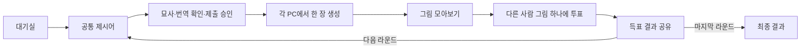

# Windows PC AI 이미지 묘사 게임 — 통합 기획서

**2026-10-18 최종 결과:** 마지막 라운드 결과 확인 뒤 방장이 최종 결과를 눌러 전원이 이동한다. 모든 라운드의 표를 합산해 단독/공동 1위를 표시하고 전원 0표이면 1위를 만들지 않는다. 결과의 방 나가기는 메인화면으로 복귀하며, 방장이 먼저 나가도 참가자 화면은 유지한다. 규칙은 `multiplayer-results-v9`, 최신 `testbuild`는 **953,004,463바이트 / 455개 파일**이다. 로컬 모의 3인·실제 2인 공동 1위·16인 가로 스크롤과 복귀를 확인했다. [동작·검사·배포](docs/FINAL_RESULTS_REPORT.md). 아래 최종 우승 미정 설명은 과거 기록이다.

**2026-10-18 사운드 적용:** 포근한 작업실 분위기의 메인/인게임 BGM 2곡과 효과음 7종을 제작했다. 공통 클릭음, 상태별 1회 재생, 미제출·미투표자 5~1초 마감음, 0.8초 BGM 교체, BGM/SFX 개별 음량·0% 음소거를 지원한다. 음원은 **9.33MB**, 최신 `testbuild`는 **952,974,286바이트 / 455개 파일**이다. 실제 싱글·로컬 2인 생성·3인 모의 투표와 오디오 검사는 통과했으며 최종 청감 확인은 남아 있다. [음원·재생·검사 기록](docs/SOUND_REPORT.md). 아래 사운드 미구현 기록은 이전 상태다.

**2026-10-17 종료 오류 수정:** 그림 제출 후 투표 카드의 접근성 이름을 만드는 과정에서 발생하던 예외를 수정했다. 최종 EXE의 실제 로컬 2인 생성·전송·1:1 결과를 확인했다. 최신 `testbuild`는 **943,598,864바이트 / 444개 파일**이다. [원인·수정·검사](docs/GALLERY_CRASH_REPORT.md).

**2026-10-17 재개 완료:** 단일 창·라이트/다크·공통 설정·닉네임·통합 대기방·툴팁의 최종 소스를 테스트 빌드와 맞췄다. 최종 배포본에서 실제 싱글 3장과 3인 TCP·모의 AI 2라운드를 재검사했다. 최신 `testbuild`는 **943,596,302바이트 / 444개 파일**이다. [완료 범위·검사](docs/SHELL_LOBBY_REPORT.md).

**2026-10-15 최신:** 한 창에서 메인·그림그리기·멀티·경기를 전환하고 우측 상단의 공통 설정에서 라이트/다크·해상도·음량을 저장한다. 생성/참가 시 닉네임을 입력하며 대기방은 왼쪽 참가자 목록/오른쪽 방 설정 하나로 통합한다. 참가자는 준비 완료, 방장은 다른 참가자 전원 준비 후 게임 시작을 누른다. 설정·명단 변경 시 준비를 해제한다. CFG·Steps·Seed 이름에는 1초 지연 설명 툴팁을 제공한다. 최신 규칙은 `multiplayer-waiting-v8`, `testbuild` 전체는 **943,594,766바이트 / 444개 파일**이다. 실제 싱글·로컬 멀티 생성과 실제 EOS 단일 참가자 속성 저장을 확인했으며 다른 PC EOS 경기는 미검증이다. [상세 구현·검사](docs/SHELL_LOBBY_REPORT.md). 아래 새 창·두 대기방·이전 버전 기록은 과거 상태다.

**2026-10-14 화면 통일:** 싱글·멀티의 입력창·파라미터·대기방·투표 카드에 메인 메뉴와 같은 공통 테마를 적용했다. 투표 단계에서는 그림 영역을 넓히고 다음 라운드에서 작성 화면을 복원한다. 최신 `testbuild`는 **943,547,171바이트 / 444개 파일**이며 실제 싱글 생성과 3인 멀티 모의 경기·같은 PC TCP 검사를 통과했다. [상세 변경·검사](docs/UI_THEME_REPORT.md).

**2026-10-14 최신:** 메인 메뉴를 연한 배경·그림 카드·보라색 버튼으로 꾸미고, 같은 PC의 독립 앱들이 기존 방 코드로 자동 참가하도록 로컬 TCP를 연결했다. 온라인/로컬 선택 메뉴는 없다. 같은 Windows 사용자에서 실행하며 로컬·외부 PC 참가자를 한 방에 섞지 않는다. 실제 앱 3개의 Tiny-SD 생성·PNG 전송·투표까지 확인했다. 최신 `testbuild` 전체는 **943,543,075바이트 / 444개 파일**이다. [사용법·기술·검증 범위](docs/LOCAL_MULTIPLAYER_REPORT.md).

**2026-10-08 멀티플레이 진입 변경:** 방 생성/방 참가 카드 → 생성 설정 또는 방 코드 입력 → 내부 자동 접속 → 참가자 대기 화면으로 진행한다. 방 코드 10자리는 우측 상단에서 클릭해 복사하며 소문자·하이픈 포함 입력을 허용한다. 사용자 승인으로 EOS 게임 클라이언트 설정을 앱에 포함했다. 최신 `testbuild/AIrtist.exe`는 전체 **943,484,515바이트 / 444개 파일**이다. 실제 단일 참가자 서비스 검사와 모의 3인 경기는 확인했고 실제 여러 PC 검사는 남아 있다. [상세 구현·검사](docs/ROOM_CODE_REPORT.md). 아래 설정 파일 선택 및 이전 패키지 수치는 과거 기록이다.

**2026-10-07 메인 메뉴·바로 그리기:** 시작 화면은 흰 배경의 AIrtist 제목과 그림 그리기·멀티 플레이·설정·종료 메뉴다. 싱글·멀티 모두 그림 그리기 한 번으로 내부 번역 후 생성하며 번역 확인 화면을 표시하지 않는다. 멀티는 번역 완료 후 기존 금지어 검사와 방장 승인을 거쳐 생성권을 소비한다. 설정은 창 해상도와 BGM/SFX 음량을 저장하며 사운드 재생은 아직 없다. 아래 번역 확인·상단 메뉴 관련 설명은 과거 기록이다. [구현·검사·테스트 빌드](docs/MAIN_MENU_REPORT.md).

**2026-10-07 테스트 빌드:** 최신 소스를 Release로 다시 게시해 `testbuild/AIrtist.exe`에 반영했다. 모델·런타임을 포함해 **943,443,042바이트 / 444개 파일**이다. 최종 경로에서 실제 파라미터 생성 4장과 자유/고정 모의 온라인 검사가 통과했고 패키지 파일 해시를 확인했다. 기존 `testbuild`는 `.cache/testbuild-before-20261007`에 보존했다. 아래 별도 패키지 경로는 이전 작업 당시 기록이다.

**2026-10-06 최신:** 좌측 CFG·Steps·Seed와 하단 프롬프트 UI를 추가했다. 방 생성의 “방 파라미터 설정”으로 공통 고정/참가자 자유 설정을 선택한다. 최신 실행 파일은 `testbuild-parameters/AIrtist.exe`, 전체 943,444,066바이트 / 444개 파일이다. 실제 생성 4장과 자유/고정 모의 3인·2라운드, 대기방 UI 검사를 통과했다. 실제 여러 PC 온라인 검증은 남아 있다. [사용법·구현·검사](docs/GENERATION_PARAMETERS_REPORT.md). 아래 경로·버전·25단계 고정은 해당 날짜의 기록이다.

- 최초 작성: 2026-09-13 / 기획 수정: **2026-09-21**
- 현재 기획: **AI 채점 폐지, 싱글플레이를 자유 그림그리기 모드로 변경, 멀티플레이는 참가자 투표로 판정.**
- 2026-10-05 실제 WPF 온라인 경로 검사: 단일 참가자의 인증·방 검색/생성/명단·나가기·같은 기기 재접속을 확인하고, 이미 종료된 worker 뒤 창 닫기가 중첩되는 오류를 수정했다. 실제 재검사·모의 3인 2라운드/종료 회귀·Release 빌드·패키지 실제 EOS/초기 화면 검사 통과. 최신 `testbuild`는 **943,420,637바이트 / 444개 파일**이다. 다른 PC의 실제 참가·P2P·PNG·투표는 미실행이며 [2PC/3PC 검사 절차](docs/MULTIPC_TEST_GUIDE.md)를 마련했다. [수정·검증 범위](docs/ONLINE_LIVE_REPORT.md)
- 2026-10-04 EOS 설정·실제 단일 참가자 검사 완료: 사용자 승인으로 개발자 계약/표준 서비스 부록 수락·게임 클라이언트와 제한된 로비 정책을 준비하고 설정 5개를 Git 제외 파일에 저장했다. 실제 Connect Device ID 로그인·방 검색/생성·명단 조회·나가기와 나간 방 검색 제외를 통과했다. 검사 도구에 `live-lobby`를 추가했고 제품 코드/`testbuild`는 그대로다. 다음은 다른 회선 2PC의 방 참가·P2P·PNG 전송과 3인 투표 검사다. 인증 취소/갱신과 실제 WPF 온라인 경기 역시 미검증이다. 아래 설정 미준비 기록은 당시 상태다. [정책·실측·실행](docs/EOS_SETUP.md)
- 2026-10-04 GPU 자원 수정·배포 완료: 공급자 재사용과 GPU 취소 방식 수정 후 실제 30장·취소/시간 초과 각 3회 복구를 통과했다. 핸들은 496→509로 기존 반복 증가 양상을 재현하지 않았고 PNG 30장은 수정 전과 같다. 전체 규칙·수명 검사와 배포 EXE의 그림그리기 3장·3인 2라운드/6장·모의 온라인·최종 실행/해시를 확인했다. `testbuild`는 **943,404,694바이트 / 444개 파일**, 중복 약 2.30GB 정리 후 작업 폴더는 약 3.75GB다. 수 시간 WPF·저사양/IME/DPI/깨끗한 PC 검증과 EOS 설정 준비 후 실제 서비스·다른 PC 검사가 남았다. 아래는 날짜별 과거 기록이다. [최신 수정·검사·제약](docs/GPU_RESOURCE_FIX_REPORT.md)
- 2026-10-03 반복 검사 후속: 실제 30장 검사 완주를 확인하고, 검사 실행을 apphost로 바꿔 배포용 DirectML/ORT와 같은 DLL로 30장·취소/시간 초과 각 3회를 추가 검증했다. 장당 약 21초지만 완료 후 핸들 증가가 남았다. 추론·PNG 없이 GPU 세션 생성/해제만으로 증가를 재현했으며 다음은 정확한 원인과 수정 후보 검증이다. 장시간 안정성 완료는 아니며 `testbuild`와 제품 코드는 그대로다. EOS 설정 5개는 계속 비어 있다. [반복·자원 진단 결과](docs/DRAWING_SOAK_REPORT.md)
- 2026-10-02 패키지 마무리: 10월 1일 검증한 최신 `testbuild`는 **943,403,670바이트 / 444개 파일**이며 그림그리기·경기 미리보기·개발용 온라인 방을 포함한다. 실제 그림그리기 3장·3인 2라운드 생성 6장/투표·기록 일치, 온라인 모의 검사와 최종 경로 실행/해시를 확인했다. 임시 중복 파일 약 1.13GB를 정리했다. EOS 설정 5개가 없어 실제 온라인 검사는 여전히 남았다. 아래 미갱신·이전 용량은 단계별 과거 기록이다. [최신 패키지·검사](docs/TESTBUILD_RELEASE_REPORT.md)
- 2026-10-01 온라인 화면 후속: 온라인 방과 전용 작업 스레드를 인증·로비·연결 합의·Core 대기방/경기에 연결했다. 모의 3인 2라운드·모의 PNG 6개·표/기록 일치·오래된 명령/종료·전체 unit·기존 UI·EOS 경계/native·Release 빌드를 통과했다. 실제 설정 5개는 비어 있어 서비스 인증·여러 PC 송수신은 미검증이며 다음 검사 대상이다. `testbuild`는 갱신하지 않았다. 아래 단계별 미연결 언급은 당시 상태다. [온라인 화면·검사](docs/ONLINE_UI_REPORT.md)
- 2026-10-01 연결 합의 단계 마무리: EOS 로비 속성을 통한 공통 연결/참가 세션 ID·전원 P2P 준비 확인과 Core 대기방 전달을 추가했다. 모의 3인 합의→대기방/경기 시작·변경 중단, 2/16인 데이터·전체 unit·Release 빌드를 통과했다. 실제 서비스는 미검증이며 온라인 화면/작업 스레드 연결이 다음이다. `testbuild`는 그대로다. [연결 합의·검사](docs/EOS_CONNECTION_REPORT.md)
- 2026-09-30 로비 후속: EOS 방 생성/검색/참가/나가기·서비스 명단/알림과 P2P 생성 명단 검증을 연결했다. 로비/P2P 대역·native 초기화/종료·Release 빌드는 통과했다. 설정이 없어 실제 서비스 호출은 미검증이며 공통 연결 범위·전원 준비 확인·온라인 화면 연결이 다음이다. `testbuild`는 그대로다. [로비 구현·검사·제약](docs/EOS_LOBBY_REPORT.md)
- 2026-09-30 최신: 공통 전송 계약과 EOS P2P 어댑터를 추가하고 SDK 경계 대역·기존 전체 규칙·WPF 대기방 검사를 통과했다. 송신자/명단·방향·소켓 범위·큐 상한과 연결 실패 처리를 구현했으며 실제 EOS 송수신은 포털 값이 없어 미검증이다. 다음은 EOS Lobby 생성/검색/참가·서비스 명단 확인·전원 연결 준비 후 게임 시작과 온라인 화면 연결이다. `testbuild`는 갱신하지 않았다. [P2P 구현·검사·제약](docs/EOS_P2P_REPORT.md)
- 2026-09-29 최신: 공식 EOS C# SDK 1.19.2.1 확보·버전/해시 고정, 별도 인증 모듈 빌드와 실제 SDK 초기화·종료·설정 검사를 완료했다. 기기 ID 로그인/갱신 코드는 추가했으나 포털 값이 없어 실제 인증은 미검증이다. WPF/로비/P2P 연결·여러 PC 검증과 `testbuild` 갱신은 남아 있다. 이전 날짜의 SDK 미준비 기록과 구분한다. [SDK·인증 결과](docs/EOS_AUTH_REPORT.md), [설정·실행](docs/EOS_SETUP.md)
- 구현 상태: 그림그리기·채점 제거·투표 규칙·한 라운드 실행기에 이어 2026-09-28 여러 라운드와 결과 기록을 연결했다. 한 PC에서 실제 3명 × 2라운드, 그림 6장과 라운드별 1/2/0표·전체 기록 일치를 검증했다. 실제 EOS/온라인 연결은 남아 있다. [최신 경기 검사](docs/MATCH_RUNTIME_REPORT.md), [채점 제거 기록](docs/SCORING_REMOVAL_REPORT.md)
- 2026-09-28 후속: 로컬 대기방의 참가자/설정·호환성 확인, 역할별 준비/취소와 방장만 경기 시작을 연결했다. 설정·명단 변경 시 전원 재준비하며 이전 접속/설정의 준비 요청과 중복 시작을 거절한다. 실제 EOS 대기방 상태 배포·온라인 연결은 남아 있다. [대기방 구현·검증](docs/LOBBY_REPORT.md)
- 2026-09-28 대기방 연결: 참가자별 상태 복제·준비 응답·전원 시작 계획 확인을 신뢰성 제어 채널에 연결했다. 전원 확인 전 작성·AI를 시작하지 않으며 준비 취소 경합·누락·위조·합의 설정 변경을 검사했다. 로컬 미리보기이며 실제 인증·동적 입퇴장·EOS 연결은 남아 있다. [동기화 보고서](docs/LOBBY_SYNC_REPORT.md)
- 이 문서와 [개발 지침](AGENTS.md)을 이후 작업 기준으로 사용한다. 기존 보고서의 AI 채점 개선·싱글 경기 계획은 과거 기록이다.
- 2026-09-24 진행: 한 라운드의 호스트 제출 승인·이미지 패킷 처리·투표 진입을 추가하고 모의 송수신을 검사했다. EOS SDK/설정은 미준비로 실제 온라인 연결 전이다. [구현 범위](docs/MULTIPLAYER_FOUNDATION_REPORT.md), [EOS 준비](docs/EOS_SETUP.md)
- 2026-09-25 진행: 참가자별 갤러리 수신·전원 준비 확인·투표/확정 결과 적용을 추가했다. 실제 PNG를 독립된 모의 상태 3개로 배포하고 같은 1/2/0표를 확인했다. 실제 EOS·온라인 UI·여러 라운드는 남아 있다. [최신 동작·검사](docs/GALLERY_SYNC_REPORT.md)
- 2026-09-26 진행: 제어 메시지 분할·재전송·ACK·중복 처리 방지와 큐/속도 제한을 구현했다. 모의 3인 갤러리·투표에서 제어 패킷 누락 후 결과 일치, 별도로 실제 로컬 UDP 소켓의 32KiB 누락 복구를 검사했다. EOS SDK·설정은 여전히 없으며 인터넷 멀티플레이 검증은 아니다. [최신 전송 구현·검사](docs/CONTROL_TRANSPORT_REPORT.md)
- 2026-09-27 진행: 시작·제출 승인·이미지 전송 허가 메시지를 연결하고 모의 3인 라운드 시작부터 투표 결과까지 검사했다. 제어 패킷 78개 누락에도 참가자당 생성 입력 한 번·1/2/0표 결과가 유지됐다. 실제 AI/EOS 실행·이미지 누락 복구·온라인 UI는 남아 있다. 현재 규칙은 `multiplayer-round-v3`다. [최신 구현·검사](docs/ROUND_DISPATCH_REPORT.md)
- 2026-09-27 후속: 업로드·갤러리 이미지 누락 복구·송신량 제한·완료/생성 실패 통지를 연결했다. 모의 3인에서 이미지 216개·제어 174개 패킷 누락 후 전송 12건 완료와 결과 일치를 검사했다. 당시 규칙은 `multiplayer-round-v4`다. [이미지 전송 단계 기록](docs/IMAGE_RECOVERY_REPORT.md)
- 2026-09-27 최신: 호스트 타이머·상태/결과 배포·실제 번역/생성·경기 미리보기를 연결했다. 현재 규칙은 `multiplayer-round-v5`다. 실제 PNG 3장 합계 1,294,269바이트를 생성·전달하고 3명의 최종 결과 일치를 확인했다. 한 PC의 메모리 내 연결이며 EOS/온라인 UI·여러 라운드·여러 PC 검증은 남아 있다. `testbuild`는 갱신하지 않았다. [실행기·검사 보고서](docs/ROUND_RUNTIME_REPORT.md)

## 1. 두 모드의 목적

2026-09-28 최신 규칙은 `multiplayer-match-v6`다. 미리보기는 1~10라운드(기본 3)를 선택하고 전원 확정 결과/AI 정리 확인 뒤 방장이 다음 라운드를 시작한다. 결과 확인 30초·연결 확인 요청 2초/응답 부재 15초는 임시 정책이다. 이탈·결과 불일치·시간 초과에는 기록을 보존하고 중단한다. 최종 우승 기준은 미정이므로 라운드별 득표 기록만 표시한다. 아래 v5 이전 진행 항목은 단계별 기록이다. [구현·검사·제약](docs/MATCH_RUNTIME_REPORT.md)

**그림그리기 모드**에서는 플레이어가 원하는 대상을 자유롭게 묘사해 AI로 그림을 만든다. 제시어·채점·승패가 없으며 원하는 문장으로 다시 생성할 수 있다. 기존 싱글플레이 모드의 이름과 경기 규칙을 대체한다.

**멀티플레이**에서는 같은 제시어를 직접 쓰지 않고 자연어로 묘사한다. 각 PC에서 생성한 그림들을 함께 보여주고 각 플레이어가 다른 사람의 그림 하나에 투표한다. 자기 그림에는 투표할 수 없다. AI가 그림의 유사도나 점수를 계산하지 않는다.

멀티플레이 예시: 제시어 `사과` → 묘사 `아삭아삭하고 빨간 과일` → 생성한 그림 공유 → 참가자가 그림을 보고 투표. 그림그리기에서는 `빨간 사과`처럼 대상 이름을 직접 써도 된다.

두 모드 모두 묘사의 의미가 드러나는 단순한 2D 그림을 목표로 한다. 명암·재질보다 색·형태의 차이가 중요하며 정답 아이콘 검색으로 생성을 대체하지 않는다.

## 2. 요구사항과 결정 상태

| 항목 | 내용 | 상태 |
|---|---|---|
| 플랫폼 | 게임 엔진 없는 Windows PC 설치형 앱 | 확정 |
| 그림그리기 | 제시어·채점 없이 자유 입력과 반복 생성 | 2026-09-21 구현·현재 PC 검증 완료 |
| 멀티플레이 판정 | 그림들을 함께 표시, 1인 1표, 자기 그림 투표 금지 | 실제 AI 로컬 경기·온라인 화면 연결 완료, 실제 EOS 서비스는 미검증 |
| AI 채점 | 제품의 채점 기능·모델·벡터·점수식을 제거 | 2026-09-22 코드·배포물 제거와 실행 검증 완료 |
| 멀티플레이 묘사 규칙 | 공통 제시어와 금지 별칭, 라운드당 승인된 생성 1회 | 변경 요청이 없는 기존 규칙 유지 |
| 한국어 입력 | 로컬 번역 후 생성 전 확인·수정 | 그림그리기·경기 미리보기 연결 완료, 의미 보존 한계는 유지 |
| 설치 용량 | 필수 파일 합계 1,000,000,000바이트 이하 목표 | EOS 포함 testbuild 943,404,694바이트, 깨끗한 PC·최종 배포 검증은 별도 |
| 모델 설치 | 모델·토크나이저 동봉, 최초 실행 시 추가 다운로드 없음 | 유지 |
| 생성 실행 | 각 플레이어 PC에서 실행, 유료 AI API 없음 | 유지 |
| 무료 연결 | 별도 임대 게임 서버 없이 방 생성·참가 | EOS Lobbies/P2P 구현, 실제 서비스 검증 대기 |
| 모델과 경량화 | 공개 Tiny-SD, 추가 학습 없는 양자화·TAESD | 기존 검증 구성 재사용 |
| 언어·화면 | C# + WPF, 추론은 검증된 라이브러리에 위임 | 현재 구현 선택, 사용자 언어 지정은 아님 |

설치 후 필수 파일 합계와 압축 설치 파일 크기, 실행 중 RAM·VRAM, 플레이 후 그림·캐시 크기는 구분한다. 무료 연결 목표는 생성 API와 별도 임대 게임 서버의 사용료를 없애는 의미이며 플레이어 PC의 연산은 사용한다.

## 3. 모드별 플레이 흐름

### 3.1 그림그리기 모드

1. 원하는 내용을 한국어 또는 영어로 자유롭게 입력한다.
2. 로컬 번역을 확인·수정하거나 원문 작성으로 돌아간다.
3. 최종 묘사를 확정하고 한 장을 생성한다.
4. 그림을 확인하고 묘사를 바꾸거나 다시 생성한다.

제시어·정답 금지 별칭·라운드 수·경쟁용 작성 제한 시간·생성권 소비·점수·승패는 없다. 한 번에 한 생성 작업만 실행하고 취소·실패·기술적 시간 초과 후에는 다시 시도할 수 있게 한다. 이전 작업의 늦은 결과가 새 작업 화면을 덮어쓰면 안 된다.

기존 번역 확인·수정을 재사용하는 것이 전환 기본안이다. 그림 저장·작품 보관함·추가 편집 도구는 이번 확정 범위에 포함하지 않는다.

### 3.2 멀티플레이

1. 방장이 라운드 수, 작성 제한 시간, 생성 제한 시간을 설정하고 참가자를 모은다.
2. 동일한 제시어를 모든 참가자에게 전달한다.
3. 각자 제시어를 직접 쓰지 않은 묘사를 작성하고 번역을 확인·수정한다.
4. 최종 묘사를 방장이 승인하면 해당 라운드의 생성 기회를 소비한다.
5. 각 PC에서 한 장을 생성하고 완성된 실제 이미지 바이트를 공유한다.
6. 전원 완료 또는 생성 마감 후 유효한 제출 그림들을 함께 표시한다.
7. 각 플레이어가 자기 그림을 제외한 하나에 투표한다.
8. 방장이 유효 표를 집계하고 득표 결과를 공유한 뒤 다음 라운드 또는 최종 결과로 진행한다.



내부 번역까지 작성 시간에 포함하고 제출 승인 때 생성 기회를 소비하는 규칙은 멀티플레이에만 적용한다. 번역 준비·재작성은 생성권을 소비하거나 작성 시간을 초기화하지 않는다. 라운드 투표 제한 시간·선택 변경·기권 등에는 임시 정책이 남아 있다. 최종 우승은 누적 득표로 정하며 같은 최다 표는 공동 1위, 전원 0표이면 1위 없이 표시한다.

## 4. 엔진 없는 앱과 Tiny-SD 구성

### 4.0 구현 언어 판단: C# + WPF 추천

사용자는 특정 언어를 지정하지 않았으며 게임 엔진 없이 개발하기를 원한다. 현재 게임은 한국어 입력, 대기실, 타이머, 이미지와 결과 화면이 중심이므로 **C# + WPF로 Windows 앱을 구현하는 구성을 추천한다.** WPF는 게임 엔진이 아닌 Windows용 UI 프레임워크이며, 화면 배치·컨트롤·데이터 바인딩·그래픽 표시를 제공한다. [Microsoft WPF 설명](https://learn.microsoft.com/en-us/dotnet/desktop/wpf/overview/)

이 추천은 실행 파일의 절대 최소 크기보다 Windows UI 개발, 유지보수, AI·네트워크 연결을 함께 고려한 판단이다. EOS는 C# SDK를 제공하고 ONNX Runtime도 C# API를 제공하므로, 게임 전체를 AI 연구 코드의 언어에 맞출 필요가 없다. SDK 제공이 Tiny-SD 변환이나 게임 연결까지 자동으로 해결한다는 뜻은 아니다. [EOS SDK 안내](https://onlineservices.epicgames.com/licensing), [ONNX Runtime C# 안내](https://onnxruntime.ai/docs/get-started/with-csharp.html)

| 선택지 | 현재 판단 |
|---|---|
| C# + WPF | 주 앱 추천. 화면·입력·경기 규칙·EOS 연결 구현에 사용 |
| C++ + Win32 등 | 앱 기본 용량을 더 엄격히 줄여야 할 때 대안. 직접 처리할 UI 작업과 메모리 관리 부담을 함께 고려 |
| Python + GUI | 구현 가능하며 모델 실험·변환 도구로 활용 가능. Python을 사용해야 한다는 이유로 제품의 주 언어를 고정하지 않음 |

Windows x64용 자체 포함 배포(self-contained)로 필요한 .NET 런타임을 함께 제공하고 그 크기를 1GB 예산에 포함한다. 런타임을 사용자에게 별도 다운로드하도록 해서 용량을 작게 계산하지 않는다. 자체 포함 배포도 OS·네이티브 의존성을 모두 해결하는 것은 아니므로 필요한 배포 DLL을 확인한다. WPF에 대한 검증 없이 Native AOT나 트리밍으로 용량이 해결된다고 가정하지 않는다. [Microsoft .NET 배포 문서](https://learn.microsoft.com/en-us/dotnet/core/deploying/)

기획 변경 후 실행 구성:

```text
C# + WPF: 그림그리기 화면·멀티 경기와 투표 규칙
  ├─ EOS C# SDK 연결부: 로비·참가자 연결·결과 공유
  ├─ AI 실행 연결부: 검증된 네이티브 추론 라이브러리 호출
  │    └─ 로컬 번역·확인 → Tiny-SD → 완성 이미지
  ├─ 멀티플레이 투표: 그림 모아보기·투표 검증·호스트 집계
  └─ 필요할 때만 C++ DLL 또는 별도 AI 작업 프로그램 사용
```

AI 연산은 추론 라이브러리가 처리한다. 생성 작업은 UI를 멈추지 않도록 백그라운드에서 실행하며 진행·완료·실패를 앱에 전달한다. C#에서 직접 호출할 수 있는 구성이 검증되면 별도 C++ 프로그램을 만들 필요는 없다.

### 대체 모델 비교 중단 판단

DM-GAN에는 공개 사전학습 모델이 있어 이미지 생성 자체에 반드시 추가 학습이 필요한 것은 아니다. 다만 공식 구현은 Python 2.7·PyTorch 0.4 기반이고, 확인한 자료만으로 이 게임에서의 추론 RAM·VRAM, 간접 묘사 품질, 전체 배포 크기가 Tiny-SD보다 유리하다고 판단할 수 없다. **DM-GAN이 더 무겁다고 단정해서 제외하는 것이 아니라, 교체의 실익이 확인되지 않은 상태에서 개발 범위를 늘리지 않기 위해 제외한다.** [DM-GAN 공식 구현·사전학습 안내](https://github.com/MinfengZhu/DM-GAN)

DM-GAN·DF-GAN·IconShop 비교를 구현 선행 단계에서 제거한다. 공개 사전학습 Tiny-SD를 사용하고, 추가 학습 없이 가능한 경량화와 실제 게임 묘사 검증에 집중한다. 품질이나 용량이 목표를 충족하지 못하면 결과를 바탕으로 제약을 재논의하며, 자동으로 새 모델 학습·미세조정 프로젝트로 확장하지 않는다.

명암·사실적인 재질은 필요 없지만 ‘빨간 과일’의 색과 ‘길쭉한 모양’의 형태는 유지해야 한다. 단순한 평면 그림과 의미가 불분명하게 뭉개진 그림을 같은 허용 품질로 취급하지 않는다. 단순한 화풍을 요청한다고 Tiny-SD 가중치에서 명암 관련 용량이 자동 제거되지는 않는다.

### Tiny-SD의 AI 구성

```text
한국어 묘사
  → 공통 입력 검사 (멀티플레이만 제시어 금지어 검사)
  → 로컬 한국어→영어 번역 및 확인·수정
  → 생성 요청 (멀티플레이는 호스트 제출 승인)
  → Tiny-SD의 텍스트 인코더
  → 양자화한 Tiny-SD 이미지 생성기
  → 작은 복원기 TAESD
  → 최종 이미지
```

Tiny-SD 양자화·TAESD와 C# 실행을 그림그리기에 연결하고 채점 자산·구형 코드를 제거했다. 투표는 로컬 UI·호스트 규칙을 구현했으며 실제 온라인 경기 연결은 남아 있다. 생성 품질과 하드웨어 지원 범위에도 한계가 남는다.

### 4.1 Tiny-SD를 출발점으로 사용

Tiny-SD는 이미 공개된 증류 이미지 모델이다. 이를 가져와 사용하면 우리가 큰 모델을 처음부터 학습하거나 증류 과정을 다시 수행할 필요는 없다. [모델 카드](https://huggingface.co/segmind/tiny-sd)

다만 제작진은 복합 개념 조합과 일반적인 생성 품질의 한계를 명시한다. 이 게임에서는 정답 명칭을 제외한 간접 묘사를 잘 반영하는지가 특히 중요하므로, 작은 파일 크기만으로 채택하지 않는다. [제작진 구현·한계 설명](https://github.com/segmind/distill-sd)

### 4.2 기존 가중치 양자화

우선 8비트 양자화를 검토하고, 품질이 민감한 부분은 원래 정밀도를 유지하는 혼합 방식을 비교한다. 더 강한 4비트 압축은 필요성과 품질을 확인한 뒤 검토한다.

학습 후 양자화는 일반적으로 새로운 모델 학습 없이 수행할 수 있다. 정적 양자화에서는 대표 입력을 실행해 보정 값을 구할 수 있다. 이 보정은 모델을 처음부터 학습하는 작업과 다르다. [ONNX Runtime 양자화 문서](https://onnxruntime.ai/docs/performance/model-optimizations/quantization.html)

| 방법 | 목적 | 추가 학습 |
|---|---|---|
| 양자화 | 가중치 정밀도를 낮춰 크기 축소 | 보통 불필요. 보정·평가 필요 가능 |
| 공개 소형 부품 교체 | 큰 복원기 등을 작은 호환 모델로 대체 | 호환되는 공개 가중치라면 불필요 |
| 구조 가지치기 | 층·채널·블록 제거 | 품질 회복 학습이 필요한 경우가 많음 |
| 직접 증류 | 큰 모델의 동작을 작은 모델에 학습 | 필요 |

현재 범위는 추가 학습 없는 양자화와 공개 부품 교체다. 품질 회복 학습이 필요한 가지치기, 직접 증류, 미세조정, 새 모델 학습은 개발 계획에 포함하지 않는다. 양자화 보정과 품질 평가는 수행하되, 학습을 통한 품질 보완을 전제하지 않는다.

### 4.3 TAESD로 복원기 교체

복원기는 생성 과정의 중간 표현을 최종 이미지로 바꾸는 모델이다. TAESD는 Stable Diffusion용으로 공개된 작은 인코더·디코더이며, 큰 VAE를 대체하는 후보로 검토한다. 텍스트→이미지 생성에 필요한 디코더만 배포할 수 있는지도 확인한다. [TAESD 공식 저장소](https://github.com/madebyollin/taesd)

교체 후 색감·세부 표현과 입력 스케일 처리가 맞는지 검증한다. TAESD 자체가 텍스트에서 그림을 생성하는 전체 모델을 대신하는 것은 아니다.

### 4.4 실행 라이브러리

제품에는 필요한 모델과 실행 파일·DLL만 포함한다. ComfyUI·Python·PyTorch 개발 환경 전체를 그대로 게임에 묶는 구조는 피한다.

ONNX Runtime의 C# API를 우선 검토하되, Tiny-SD 변환·축소 구조·선택한 양자화 연산을 실제로 지원하는지 먼저 확인한다. DirectML·CUDA 등 백엔드는 변환 모델의 실행 가능성, 속도, 필수 DLL 크기를 측정해 선정한다. C# API가 있다는 사실만으로 모든 GPU와 양자화 모델이 지원되는 것은 아니다. [ONNX Runtime C# 패키지](https://onnxruntime.ai/docs/get-started/with-csharp.html)

대안으로 stable-diffusion.cpp 같은 네이티브 실행기를 검토할 수 있지만 Tiny-SD 호환성은 별도로 검증해야 한다. 필요한 경우에만 C++ 연결부나 별도 작업 프로그램을 추가한다. C/C++ 라이브러리라는 이유만으로 임의의 압축 모델이 즉시 호환된다고 가정하지 않는다. [stable-diffusion.cpp](https://github.com/leejet/stable-diffusion.cpp)

## 5. 설치 용량 정리

### 5.1 확인된 Tiny-SD 원본 크기

| 부품 | 공개 FP16 파일 크기 | 대부분의 가중치를 8비트로 저장했을 때의 단순 계산 |
|---|---:|---:|
| 이미지 생성기 U-Net | 약 647MB | 약 324MB |
| 텍스트 인코더 | 약 246MB | 약 123MB |
| 기존 VAE | 약 167MB | TAESD 교체를 검토 |
| 원본 세 부품 합계 | 약 1,060MB | 변환 결과 측정 전 |

출처: [U-Net 파일](https://huggingface.co/segmind/tiny-sd/tree/main/unet), [텍스트 인코더 파일](https://huggingface.co/segmind/tiny-sd/tree/main/text_encoder), [VAE 파일](https://huggingface.co/segmind/tiny-sd/tree/main/vae).

오른쪽 숫자는 초기 파라미터 기반 추정이며 실제 변환 파일 크기가 아니다. 3단계 최소 앱은 모델·.NET·WPF·ORT·동봉 DirectML을 포함해 **955,579,203바이트**로 측정했다. EOS·추가 에셋·완성된 경기 기능까지 포함한 최종 게임의 1GB 달성을 확정한 것은 아니다. [구성별 집계](docs/APP_STAGE3_REPORT.md)

전체 설치 크기는 다음 항목을 모두 합산한다.

- 이미지 생성기, 생성용 텍스트 인코더, 토크나이저, 복원기
- 한국어 번역 모델과 해당 토크나이저
- 멀티플레이 제시어 목록·투표 규칙 데이터 (채점 모델·벡터는 제외)
- C# 게임 실행 파일, WPF 및 .NET 필수 런타임, 폰트, 사운드, 에셋
- AI 실행 라이브러리와 필수 배포 DLL
- EOS 등 네트워크용 필수 파일

현재 투표 미리보기 포함 패키지는 **922,301,469바이트 / 439개 파일**, 1GB 목표 대비 **77,698,531바이트** 여유다. 채점 제거 직후 922,253,413바이트에서 코드·사용법 등 48,056바이트가 늘었으며 새 모델·의존성은 없다. 생성용 텍스트 인코더·토크나이저는 유지한다. EOS·설치 프로그램을 포함한 최종 용량과 깨끗한 PC 실행은 별도 검증한다. [투표 패키지](docs/VOTING_REPORT.md), [채점 제거 당시 측정](docs/SCORING_REMOVAL_REPORT.md)

### 5.2 이전 SD 1.5 추정 정정

확인한 SD 1.5 Q4_0 GGUF 배포 파일은 약 1.57GB다. 이를 사용하는 이전 구성은 번역·채점·게임까지 합쳐 약 1.8~2.2GB로 추정했으므로 1GB 목표용 최종 구성으로 채택하지 않는다. 이는 해당 배포본 기준이며 SD 1.5의 모든 변환 방식에 대한 최소 크기 주장은 아니다. [배포 파일](https://huggingface.co/second-state/stable-diffusion-v1-5-GGUF/tree/main)

### 5.3 용량과 속도의 구분

- 설치 파일을 압축해도 설치 후 필수 파일이 같은 비율로 줄지는 않는다.
- 낮은 해상도·적은 생성 단계는 주로 연산량을 줄이며 가중치 파일을 자동으로 줄이지 않는다.
- 양자화로 파일을 줄여도 VRAM과 생성 시간이 같은 비율로 감소하지 않는다.
- 저장 이미지와 캐시는 별도 상한·정리 정책을 마련한다.

## 6. PC 사양과 VRAM

Tiny-SD의 공식 모델 카드에는 최소·권장 PC 사양표가 없다. 공개 속도 비교는 A100 80GB에서 수행했으며, 이것이 실행에 80GB가 필요하다는 뜻은 아니다. 제작진은 원본 SD 대비 최대 30%의 VRAM 절감을 설명하지만, 이를 특정 PC의 절대 사용량으로 환산하지 않는다. [모델 카드](https://huggingface.co/segmind/tiny-sd), [제작진 설명](https://github.com/segmind/distill-sd)

아래는 **512×512 이미지 한 장씩 생성하는 초기 테스트 기준**이다. 동작이 확인된 최소·권장 사양이나 하드웨어 구매 권장은 아니다.

| 항목 | 초기 테스트 기준 |
|---|---|
| 운영체제 | Windows 64비트, 지원 버전은 배포 단계에서 확정 |
| GPU | 초기 실험은 NVIDIA CUDA, 현재 앱은 ONNX Runtime DirectML 사용. 다른 GPU는 별도 검증 |
| VRAM 4GB | 낮은 사양 지원 여부를 확인할 기준 |
| VRAM 6~8GB | 첫 개발·성능 검증용 기준 |
| 시스템 RAM | 16GB를 기준으로 개발, 8GB 지원은 별도 측정 |
| VRAM 2GB | 추가 최적화가 필요한 도전 목표 |
| AMD·Intel GPU | 실행 라이브러리 및 양자화 연산 지원 검증 필요 |
| 내장 GPU·CPU | 별도 성능 검증 필요, 제한 시간 내 생성 보장 없음 |
| CPU 구체 모델 | 미정 |

실행 중에는 모델 가중치 외에 중간 계산 결과, 작업 공간, 게임 화면용 메모리도 필요하다. 번역·생성을 순서대로 실행하고 GPU 모델의 상주 시간을 관리한다. 필요하면 일부 모델을 시스템 RAM으로 옮기는 오프로딩을 검토하지만, 데이터 전송으로 생성 시간이 늘 수 있다. [메모리 최적화 설명](https://huggingface.co/docs/diffusers/optimization/memory)

GTX 1660 Ti 6GB에서 원본 가중치를 FP32로 실행한 초기 측정은 완료했다. 512×512·25단계 기준 첫 정상 생성은 8.244초, 이후 50회 평균은 7.938초였다. 이 환경의 FP16 실행은 비정상 수치로 실패했다. 구체 환경·측정 범위·품질 한계는 [원본 검증 결과](outputs/tiny-sd/BASELINE_REPORT.md)에 기록했다. VRAM 크기만으로 GPU 속도를 판단하지 않는다. 같은 4GB라도 GPU 모델에 따라 제한 시간 통과 여부가 달라질 수 있다.

## 7. 자연어 입력과 모드별 검사

생성 전 번역 확인·수정을 두 모드에서 재사용한다. 한국어 입력과 의미가 같은 수동 영어 묘사를 비교해 번역과 생성의 한계를 구분한다. 번역은 원문에 없는 대상 이름이나 속성을 추측해 추가하지 않는다.

현재 앱은 OPUS-MT 기반 로컬 번역을 사용한다. 후속 TC big 후보는 다의어·부정·형태 회귀로 미채택했다. 확인·수정 기능은 오역을 사람이 고칠 수 있게 하지만 자동 번역 정확도가 향상됐다는 뜻은 아니다. [번역 검증](docs/TRANSLATION_QUALITY_REPORT.md), [확인·수정 구현](docs/TRANSLATION_REVIEW_REPORT.md)

| 검사 | 그림그리기 | 멀티플레이 |
|---|---|---|
| 입력 길이·형식·특수 토큰 | 공통 기술 제약 적용 | 공통 기술 제약 적용 |
| 대상 이름 직접 사용 | 허용 | 현재 제시어의 금지 별칭 검사 |
| 번역 확인·수정·원문 복귀 | 재사용 | 재사용, 최종 영어 묘사도 금지 별칭 검사 |
| 경쟁용 작성 마감 | 없음 | 기존 임시 규칙 유지 |
| 최종 확정 후 재생성 | 이전 작업 종료 후 가능 | 승인된 라운드당 생성 1회 |

기존 길이 제한은 원문 2~160자, 확정 영어 2~320자다. 모드 전환 시 재사용할 기술적 기본값이며 자유 입력을 무제한 입력으로 해석하지 않는다. 한국어 IME 조합 중 Enter가 의도치 않은 제출을 만들지 않게 한다.

생성기와 번역기에는 플레이어 묘사와 공통 스타일만 전달한다. 멀티플레이 제시어는 출제·화면 표시·금지어 검사에만 사용하며 생성 입력에 섞지 않는다. 그림그리기에는 숨은 제시어나 그에 따른 금지 별칭이 없다. 멀티플레이의 띄어쓰기·유니코드·별칭·외국어 검사 범위는 명시하고, 기존 짧은 별칭으로 인한 과잉 차단은 별도 개선 과제로 남긴다.

## 8. 멀티플레이 출제·그림 표시·투표

### 8.1 출제

공통 제시어를 간접적으로 묘사하는 기존 규칙은 유지한다. 단어 목록에서 프로그램이 추첨하며, 이를 AI의 새 단어 생성으로 설명하지 않는다. 2026-10-19 `data/words.json`을 동물·사물·음식·자연·탈것/장소 각 24개, 총 120개로 확장했다. 이 목록은 출제와 금지어 검사용으로 모델의 학습 범위나 생성 가능 대상을 제한하지 않는다. 전체 대상의 실제 생성 품질·난이도는 아직 일괄 검수하지 않았다. [목록과 관리 기준](docs/WORD_CATALOG.md).

단어에는 고정 ID, 한국어 표시명, 뜻, 금지 별칭을 둔다. 동음이의어는 의미별 ID와 설명을 분리한다. 출제 데이터는 채점 벡터와 분리하고 그림그리기 시작에는 필요하지 않게 한다.

### 8.2 그림 모아보기

생성·수신이 완료되어 유효하게 제출된 그림을 한 화면의 목록이나 스크롤로 함께 보여준다. 플레이어가 실제 그림을 비교해 선택할 수 있어야 한다. 자신의 그림도 보이지만 투표할 수 없다는 상태를 명확히 표시한다.

그림은 경기·라운드·그림 ID와 소유자 ID를 연결해 관리한다. 화면 순서나 표시 닉네임으로 소유권을 판정하지 않는다. 수신 실패·미완성 이미지는 정상 투표 대상으로 취급하지 않으며, 후보가 부족할 때 라운드를 어떻게 끝낼지는 별도 정책이 필요하다. 작성자 이름 공개와 배치 순서는 미정이다.

### 8.3 한 사람당 한 표와 호스트 검증

확정 요구는 **다른 사람의 그림 하나에 투표**하는 것이다. 한 라운드에서 한 사람의 유효 표는 하나만 존재한다. 투표를 바꿀 수 있는지는 아직 미정이며 여러 그림에 표를 누적하는 기능은 없다.

호스트는 다음 정보를 검증한다.

- 송신 연결의 참가자와 투표자 ID가 일치하는가.
- 현재 경기·라운드·상태 버전의 투표 단계인가.
- 대상 그림이 이번 라운드의 유효한 제출 목록에 있는가.
- 대상 그림의 소유자가 투표자 자신이 아닌가.
- 같은 투표 요청의 재전송 또는 이미 처리한 표인가.

중복 재전송은 결과를 다시 알려줄 수 있지만 표를 중복 가산하지 않는다. 선택 변경은 정책이 정해지기 전까지 임의로 허용하지 않는다. 투표 가능 시간과 권한은 Core/호스트에서 판정하며 버튼 비활성화만으로 보장하지 않는다.

### 8.4 결과와 미정 정책

방장이 유효 득표수를 확정해 참가자들에게 같은 결과를 전달한다. AI 유사도·0~100점 변환·자동 심사·AI 동점 판정을 사용하지 않는다. 라운드 승자·동점·전체 우승·누적 득표 또는 승수 규칙은 확정 후 반영한다.

최종 투표 제한 시간, 기권, 투표 변경, 실패자의 자격, 이탈·재접속, 그림 부족 처리 정책은 아직 미확정이다. **2명만 있고 서로에게 한 표씩 주면 항상 1:1**이 되므로 최소 인원과 2인 방 처리도 확정해야 한다. 이를 이유로 최소 3인을 이미 확정된 요구로 취급하지 않는다.

2026-09-23 로컬 미리보기의 **임시 기본값**은 60초·전원 투표 시 종료·방장 조기 마감·선택 변경 불가·그림 없는 참가자도 투표 가능이다. Core는 그림 0~1개면 투표 없이 종료한다. 미투표는 표를 추가하지 않으며 동점은 공동 최다 득표로만 표시한다. 0표뿐이면 최다 득표자를 만들지 않는다. 재투표·누적 우승·이탈/재접속은 아직 구현하지 않았다. `VotingPolicy`에서 시간·조기 종료·그림 없는 사람의 자격을 변경할 수 있다. [투표 구현·검증](docs/VOTING_REPORT.md)

기존 TinyCLIP 모델·비교 벡터·점수식과 채점 자료 보강은 제품 작업에서 제외한다. 과거 측정은 [채점 실험 기록](docs/APP_QUALITY_REPORT.md)에 보존한다.

## 9. 무료 멀티플레이와 권한

독립 Windows 배포의 기존 추천은 EOS Lobbies + P2P다. 이번 기획 변경으로 연결 서비스를 바꾸지는 않는다. SDK·이용 조건·배포 요구는 실제 연동 시 다시 확인한다. [EOS 서비스 안내](https://onlineservices.epicgames.com/multiplayer)

- 각 플레이어 PC: 묘사 입력·번역·자기 이미지 생성, 수신한 그림 표시, 투표 요청.
- 방장 PC: 라운드·마감·제출 승인·이미지 수집·투표 검증·집계·확정 결과 공유.
- EOS: 로비와 참가자 연결. AI 실행 서버나 이미지 저장소가 아니다.

완성된 이미지의 실제 바이트를 공유하며 시드만 전달해 재생성하지 않는다. 파일 크기·해상도·포맷·분할 수에 상한을 두고 재조립 메모리·손상·중복·순서 변경·누락·시간 초과를 처리한다.

호스트는 `roundId + playerId`당 생성 승인을 한 번만 허용하고 승인된 묘사를 고정한다. 같은 요청의 재전송은 멱등하게 처리한다. 이 규칙은 멀티플레이에만 적용한다. 변조된 로컬 앱의 숨은 재생성까지 완벽하게 방지한다고 설명하지 않는다.

경기·라운드·참가자 ID와 상태 버전으로 오래된 제출·그림·투표·결과를 구분한다. 시작 전에 생성 모델·단어 목록·규칙·통신 버전 호환성을 확인한다. 확정 결과는 참가자도 보존할 수 있게 전달한다. 호스트 이탈·복귀 정책은 미정이며 로비 소유권 변경만으로 경기 상태가 이전된다고 가정하지 않는다.

## 10. 시스템 경계와 전환 대상

| 모듈 | 책임 |
|---|---|
| 그림그리기 진행 | 자유 입력·번역 확인·반복 생성, 취소·실패 복구 |
| 멀티 경기 진행 | 호스트의 라운드·마감·제출 승인·투표 단계·확정 결과 |
| 입력 검사 | 공통 형식 검사와 멀티플레이 금지 별칭 검사 분리 |
| 로컬 번역·생성 | 두 모드가 공유하는 로컬 AI 실행, 한 작업의 수명 관리 |
| 그림 표시·전송 | 실제 이미지 표시와 송수신·재조립·소유자 연결 |
| 투표 | 한 사람당 한 표, 자기 투표 금지, 호스트 검증·집계 |
| 로비·연결 | EOS 방·참가자 정보와 연결 상태 |
| UI | 입력·진행·그림·투표·결과 표시, Core에 명령 요청 |

두 모드는 번역·생성 기능을 공유한다. 그림그리기에 멀티 경기의 라운드·제시어·마감·생성권을 상속하지 않는다. UI가 직접 집계 결과를 확정하지 않으며 외부 SDK 타입은 연결부 안에서 변환한다.

전환 지점과 현재 상태:

| 현재 위치 | 다음 구현에서 변경할 내용 |
|---|---|
| `MainWindow.xaml` / `.xaml.cs`, `RoundPreviewWindow.xaml` / `.xaml.cs` | 그림그리기와 실제 AI를 쓰는 한 라운드 미리보기 구현. 실제 온라인 방 연결 전 |
| `DrawingController.cs` | 단어·채점 API 없는 자유 생성과 반복·취소·복구 구현 완료 |
| `VotingRound.cs` | 참가자·그림·투표 검증, 단조 시계 마감, 한 표·멱등 재전송, 호스트 집계·고정 결과 구현 |
| 구형 `MatchController.cs` / `RoundController.cs` | 삭제 완료. `MultiplayerRoundRuntime.cs`에 한 라운드·AI/전송, `MultiplayerMatchRuntime.cs`에 여러 라운드·결과 확인·기록 구현 |
| `MultiplayerProtocol.cs` | SDK 독립 계약·호환성·이미지 분할/재조립. 실제 EOS 송수신은 미연결 |
| `InputRules.cs` | 공통 입력 검사와 제시어 기반 검사 분리 완료 |
| `RuntimeAssets.cs` / `data/runtime-assets.json` | 버전 2 / `drawing-v1` 자산 28개를 검증. 채점 데이터 타입 제거 완료 |
| `WordCatalog.cs` / `data/words.json` | 채점 벡터와 독립적으로 단어를 읽고 배포. 그림그리기는 읽지 않음 |
| 구형 `ImageScorer.cs` / 전용 이미지 전처리 | 삭제 완료. 공용 PNG 생성·표시는 유지 |
| `scripts/package-app.ps1` / 모델 manifest·고지 | 채점 필수 의존성·복사 대상 제거, 공통 자산 목록 적용 완료 |
| `tests/AIrtist.Checks` / EXE 진단 | 그림그리기·단어·자산 검사와 투표 규칙·실제 PNG 목록·모의 3인 집계 검사 |

**생성용** 텍스트 인코더와 CLIP 토크나이저, ONNX Runtime·DirectML, 공용 이미지 디코딩·표시는 계속 필요하다. 이름에 CLIP이 있다는 이유만으로 함께 삭제하지 않는다. 채점 전용 실험은 과거 재현 자료로 분리하며 일반 빌드에서 실행하거나 채점 모델을 다시 설치하지 않게 한다.

## 11. 요구사항 추적과 최소 검증 세트

| 요구사항 | 최소 검증 | 완료 조건 |
|---|---|---|
| 제시어 없는 그림그리기 | `빨간 사과`, `흰 토끼` 등 대상명을 직접 입력 | 숨은 제시어·정답 금지어·점수 없이 생성 |
| 자유 반복 생성 | 번역 수정, 생성 2회 이상, 취소·실패 후 재시도 | 경기 마감·생성권에 막히지 않고 새 그림 표시 |
| AI 채점 제거 | 채점 파일 없는 새 패키지로 최초 실행·실제 생성 | 필수 파일 검사·추론·UI가 채점에 의존하지 않음 |
| 안전한 작업 수명 | 중복 실행 요청·취소 후 늦은 결과 | 동시에 한 작업, 이전 결과가 새 작업을 덮어쓰지 않음 |
| 멀티 그림 비교 | 3명 이상 참가자의 서로 다른 그림 | 모든 유효 그림 표시, 자기 그림 구분 |
| 1인 1표·자기 투표 금지 | UI와 직접 요청 모두에서 자기 표·재전송·위조·오래된 표 | 호스트가 거절하거나 멱등 처리, 중복 가산 없음 |
| 결과 공유 | 동일한 확정 표 집합으로 참가자 결과 비교 | 득표수가 일치하고 마감 뒤 변하지 않음 |
| 무료 연결·이미지 전송 | 다른 회선의 두 PC에서 연결·실제 바이트 송수신 | 제한·손상·누락·시간 초과 처리 |
| 오프라인·1GB 목표 | 개발 도구 없는 Windows의 새 패키지 | 다운로드 없는 그림그리기, 모든 필수 파일 집계 |
| 낮은 사양·반복 사용 | 별도 4GB VRAM/16GB RAM, 장시간·IME/DPI | 측정한 환경과 지원 범위 기록 |

투표 기능의 3인 테스트는 제품 최소 인원 확정이 아니다. 2인 상호 투표·그림 부족·동점·이탈도 별도 사례로 두고, 해당 정책이 미정이면 관련 완료 판정을 보류한다. 그림 품질은 사람이 묘사 반영을 확인하며 AI 채점 품질 검사를 재도입하지 않는다.

## 12. 미확정 사항과 플레이테스트 질문

- 투표 제한 시간, 전원 투표 시 조기 마감 여부, 미투표·기권, 선택 변경 허용 여부.
- 라운드별 동점·재투표 정책. 전체 우승·누적 결과 표시는 2026-10-18 확정했다.
- 생성 실패·시간 초과·이탈한 사람의 투표 자격과 그림 후보 유지 여부.
- 유효 그림이 0~1개일 때 진행, 2인 방의 상호 투표 문제, 최소·최대 인원.
- 작성자 익명 여부와 그림 배치 순서. 플레이어가 자기 그림 금지와 선택 상태를 쉽게 이해하는가.
- 제시어 목록·출제 방식·범위·난이도, 멀티 작성/생성 시간·실패 정책.
- 그림그리기의 반복 생성 흐름과 번역 확인·수정이 충분히 편한가. 저장·보관함은 별도 요구 확인 후 검토.
- 최종 화풍·해상도, Windows 지원 버전과 최소 CPU·GPU·RAM, 장시간 안정성.
- EOS 인증·방 참가·호스트 이탈·재접속 UX, 배포 경로와 설치 프로그램.

그림그리기에 제시어와 채점이 없다는 점, 멀티플레이의 1인 1표와 자기 투표 금지는 미확정 사항이 아니다.

## 13. 수정 후 구현 순서와 완료 조건

이 순서는 과거 단계 번호와 다음 채점 품질 개선 계획을 대체한다.

| 순서 | 작업 | 완료 조건 |
|---|---|---|
| 1 · 완료 | 경기·채점 호출에서 분리한 그림그리기 전환 | 제시어·점수·작성 마감 없이 번역 확인 → 생성 → 반복, 복구 검사·실제 3장 통과 |
| 2 · 완료 | 채점 전용 코드·모델·벡터·패키징 정리, 새 EXE 생성 | 채점 없는 패키지 실제 3장, 연속 6장·취소/시간 초과 복구 통과, 전체 용량 재측정 |
| 3 · 로컬 완료 | 그림 모아보기·투표 규칙·호스트 집계 | 모의 3인 한 표·자기 투표 차단·결과 일치, 2인 동점·마감·임시 정책 검사 통과 |
| 4 · 진행 중 | 여러 라운드·로컬 AI·미리보기·기록 연결, 실제 3인 2라운드 완주. EOS·온라인 로비/전송·최종 우승 정책 남음 | 실제 여러 PC에서 경기 완주, 다른 회선 전송·실패/이탈 정책 검사 |
| 5 | 저사양·장시간·IME/DPI·최종 배포 검증 | 지원 사양 근거, 깨끗한 PC 최초 실행·그림그리기·멀티 검증 |

1·2번과 3번의 로컬 구현·검증을 완료했고 **4번을 진행 중**이다. 최신 소스는 실제 AI와 여러 라운드의 시작·전환·투표·종료/기록을 경기 미리보기에 연결했다. 한 PC에서 역할을 바꾸며 진행하고 AI 실행은 직렬화한다. 다음은 **EOS 설정·SDK 준비 후 기기 ID 인증·로비·P2P 어댑터와 온라인 화면**, 다른 PC 검증이다. 최종 우승·이탈/재접속 세부 정책은 미정이다. `testbuild`는 기존 PNG 파일 선택형 투표 미리보기를 유지한다. [최신 검증과 제약](docs/MATCH_RUNTIME_REPORT.md). 채점 품질 자료 보강은 중단한다.

2026-09-23 새 패키지는 922,301,469바이트이며 기존 그림그리기와 투표 미리보기를 제공한다. 투표 진단은 기존 실제 PNG 3장을 불러왔으며 GPU 생성을 다시 실행하지 않았다. 실제 네트워크 차단·깨끗한 PC·저사양·온라인 멀티 투표 검증은 남아 있다. [상세 결과](docs/VOTING_REPORT.md)

2026-09-25 소스는 `Collecting → Distributing → Voting → Completed`를 사용한다. 전원 수신 확인까지 투표 시간을 소비하지 않는다. 갤러리 대기 기본 60초 후 미완료이면 `GalleryTimedOut`으로 중단하며 이는 이탈/실패 정책 확정 전의 임시값이다. 그림이 0~1개면 투표 없이 결과를 전달한다. 규칙 버전은 `multiplayer-round-v2`이며 이번 소스는 `testbuild`에 재패키징하지 않았다. [갤러리 동기화 보고서](docs/GALLERY_SYNC_REPORT.md)

2026-09-26 제어 채널은 최대 32KiB 본문을 1,024바이트 이하로 나누고 처리 후 ACK·순서 유지·한 번만 처리·재전송을 제공한다. 상대별 송신 대기 최대 8개/128KiB, 기본 마감 10초·재시도 500ms·초당 64패킷은 조정 가능한 임시값이다. [제어 전송 보고서](docs/CONTROL_TRANSPORT_REPORT.md)

2026-09-27 시작/제출/이미지 전송 허가 메시지 직렬화·분배를 연결했다. 응답을 큐에 넣은 뒤 ACK하며 큐가 가득 차면 최대 32KiB 응답 하나를 추가 보류한다. 승인/전송 허가 응답 대기는 임시 10초, 생성 입력 반환은 한 번뿐이다. 최초 응답까지 기다린 시간을 생성 잔여 시간에서 보수적으로 차감하고 호스트가 최종 마감을 판정한다. [경기 메시지 연결 보고서](docs/ROUND_DISPATCH_REPORT.md)

같은 날 이미지 누락 조각 재전송·완료 확인·생성 실패 통지를 연결하고 당시 규칙을 `multiplayer-round-v4`로 갱신했다. 호스트는 모든 갤러리 수신자에 하나의 이미지 송신 예산을 사용한다. 송신/미소비 결과 16개·송신 PNG 16MiB·중복 기록 256개, 기본 초당 1,024패킷·즉시 32패킷·문의 최소 500ms는 임시값이다. 실제 인터넷 처리량·최대 인원 성능을 측정한 값이 아니다. [이미지 복구 보고서](docs/IMAGE_RECOVERY_REPORT.md)

후속 v5는 실행기·공유 AI·경기 미리보기를 통합했다. 메모리 내 3인 흐름에서 실제 512×512 그림 3장을 생성하고 모든 역할의 1/2/0표 일치를 확인했다. 승인부터 생성/업로드까지 각각 22.82/21.27/21.03초였으며 로딩과 로컬 전송을 포함한다. 작은 창/150% 렌더도 확인했으나 실제 DPI 전환·IME 조작·저사양/다른 PC 검증은 남아 있다. 생성된 색·둥근 형태는 확인했고 개수 불일치 등 의미 보존 한계는 유지된다. `testbuild`는 재패키징하지 않았다. [실행기·전체 검증 범위](docs/ROUND_RUNTIME_REPORT.md)

## 14. 변경 전 구현·측정 기록

아래는 재사용할 기술 근거와 과거 결과이며 현재 제품 규칙이나 다음 작업 지시가 아니다.

- Tiny-SD 원본 검증과 추가 학습 없는 경량화·ONNX 실험을 완료했다. 원본 필수 모델은 1,062,108,664바이트, U-Net 혼합 INT8+TAESD 구성은 579,084,853바이트다. 원본·TAESD·INT8·조합 각 48장, 총 192개 품질 표본을 비교했고 형태·관계·개수 등의 한계가 남았다. [원본 결과](outputs/tiny-sd/BASELINE_REPORT.md), [경량화 결과](outputs/tiny-sd/stage2/COMPRESSION_REPORT.md)
- ONNX 생성 모델·토크나이저·스케줄러와 선정 DLL 합은 618,923,747바이트였다. DirectML graph fusion·metacommands를 끈 구성에서 512×512·25단계 생성 3건을 검증했으며 모든 GPU·옵션의 안정성 보장은 아니다. [실험 재현](experiments/tiny_sd/STAGE2.md)
- C#·WPF 번역→생성→당시 AI 채점을 연결했다. 생성 3건의 Python 대비 최대 채널 차이는 1/255였고 초기 자체 포함 패키지는 955,579,203바이트였다. [3단계 결과](docs/APP_STAGE3_REPORT.md)
- 오프라인 여러 라운드·누적/평균·최종 결과를 구현하고 실제 생성 6건과 취소/시간 초과 복구를 검사했다. 이는 새 그림그리기·멀티 투표 검증을 대신하지 않는다. [4단계 결과](docs/APP_STAGE4_REPORT.md)
- 2026-09-20 TinyCLIP 40M INT8·비교 벡터와 개발 15장/별도 21장을 비교했다. 화풍별 오판이 남았으며 해당 채점 보강은 이제 제품 작업에서 제외한다. [과거 품질 결과](docs/APP_QUALITY_REPORT.md)
- 후속 OPUS-MT TC big 혼합 4/8비트 ONNX는 173,667,124바이트였고 40+16문장을 비교했다. 의미 회귀로 미채택해 기존 번역을 유지했다. [번역 후보 결과](docs/TRANSLATION_QUALITY_REPORT.md)
- 생성 전 번역 확인·수정, 원문 복귀, 금지어·마감·중복·오래된 초안 거절을 구현했다. 실제 3라운드 검사와 당시 **963,323,328바이트** 패키지를 검증했다. 이후 `testbuild`는 그림그리기 버전으로 교체했다. [과거 확인·수정 결과](docs/TRANSLATION_REVIEW_REPORT.md), [현재 실행·빌드](docs/APP_DEVELOPMENT.md)

자동 번역 의미 보존, 별도 4GB VRAM·16GB RAM PC, 장시간 반복, 실제 IME·DPI, EOS·다른 회선 멀티플레이·깨끗한 PC 설치는 여전히 남아 있다. 개발용 변환 환경·원본/중간 모델·생성 이미지와 빌드 산출물은 제품 필수 파일과 분리하고 Git에서 제외한다.
