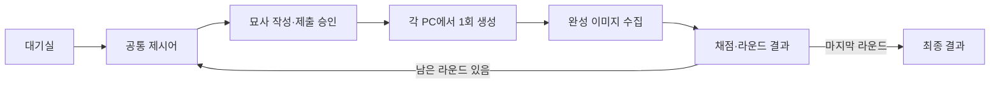

# Windows PC AI 이미지 묘사 게임 — 기획·기술 검토 정리

- 작성일: 2026-09-13
- 상태: 1·2단계 실험, 3단계 최소 앱 연결에 이어 오프라인 여러 라운드·최종 결과와 현재 PC 반복 실행·복구 검사를 완료했다. 번역·채점 품질 미달과 저사양·장시간 검증이 남아 4단계 전체 완료는 아니다. 멀티플레이·최종 배포 검증도 남아 있다. [최신 구현 결과](docs/APP_STAGE4_REPORT.md)
- 용도: 지금까지 논의한 내용을 바탕으로 개발 방향과 선행 검증 항목을 공유한다.
- 이 문서를 현재 논의의 통합 정리본으로 사용한다. 이전 문서의 500MB 목표, Qwen 중심 대안, SD 1.5만으로 1GB를 맞출 수 있다는 낙관적 추정은 현재 추천으로 사용하지 않는다.

## 1. 게임 개요

플레이어들이 같은 제시어를 보고, 그 단어를 직접 쓰지 않고 자연어로 묘사한다. 각 플레이어의 PC에 내장된 AI가 묘사를 바탕으로 이미지를 한 번 생성한다. 완성된 이미지가 제시어와 얼마나 유사한지 AI가 평가하고, 라운드 승자에게 점수를 준다.

예시:

- 제시어: 사과
- 플레이어 입력: 아삭아삭하고 빨간 과일
- 생성: 해당 묘사를 바탕으로 이미지 한 장 생성
- 평가: 생성된 실제 이미지와 사과의 유사도를 비교

싱글 플레이와 멀티플레이를 모두 지원한다. 고품질 사진보다 단순한 2D 그림 수준의 결과를 허용하지만, 묘사의 차이가 그림에 반영되어야 한다.

## 2. 요구사항과 현재 결정 상태

| 항목 | 내용 | 상태 |
|---|---|---|
| 플랫폼 | Windows PC 설치형 게임 | 사용자 방향 확정 |
| 설치 용량 | 게임과 모든 필수 AI 모델을 합쳐 1GB 이하 목표 | 사용자 목표 확정, 달성 미검증 |
| 모델 설치 | 게임 설치에 포함하고 이후 별도 모델 다운로드 없이 실행 | 기존 요청을 PC 앱에 적용한 설계 전제 |
| 이미지 생성 | 플레이어 PC의 내장 모델로 생성 | 현재 추진 방향 |
| AI 비용 | 실행 시 유료 이미지 생성 API 사용료 없음 | 사용자 요구 |
| 입력 | 한국어 자연어 묘사 | 사용자 요구 |
| 멀티플레이 | 무료 연결, 방 생성 및 참가 | 사용자 요구 |
| 싱글플레이 | 혼자서도 생성·채점·라운드 진행 | 사용자 요구 |
| 이미지 품질 | 단순한 2D·낮은 품질도 허용 | 사용자 허용 범위 |
| 경량화 | 기존 Tiny-SD의 학습 후 양자화·공개 부품 교체 검토. 추가 학습은 개발 범위에서 제외 | 최신 검토 방향 |
| 모델 | 공개 사전학습 Tiny-SD를 사용하고 DM-GAN 등 대체 모델 비교는 중단 | 사용자 의향을 반영한 추진 방향, 제품 성능 미검증 |
| 네트워크 | 독립 배포 시 EOS Lobbies + P2P | 추천 후보 |
| 엔진 | 게임 엔진을 사용하지 않고 앱으로 구현 | 사용자 결정 |
| 구현 언어·GUI | 언어 제한 없이 적합성으로 선정. C# + WPF를 주 앱 구성으로 추천 | Python 고정 아님, 기술 판단에 따른 추천 |

용량은 임시로 설치 후 필수 파일 합계 **1,000,000,000바이트** 이하로 정의한다. 압축 설치 프로그램의 다운로드 크기, 실행 중 RAM·VRAM 사용량, 플레이 후 저장된 그림·캐시는 구분해서 관리한다.

무료 운영은 생성 API 및 별도 임대 게임 서버의 사용료를 없애는 의미다. 플레이어 PC의 연산·전력은 사용하며, 개발 장비·배포 경로까지 모든 비용이 자동으로 없어지는 것은 아니다.

## 3. 기본 플레이 흐름

1. 방장이 방을 만들고 라운드 수, 묘사 작성 제한 시간, 이미지 생성 제한 시간을 설정한다.
2. 다른 플레이어가 참가한다.
3. 모든 플레이어에게 동일한 제시어를 보여준다.
4. 각 플레이어가 제시어를 직접 포함하지 않는 묘사를 작성한다.
5. 유효한 제출을 승인하면 해당 라운드의 생성 기회를 사용한다.
6. 각 PC에서 이미지 한 장을 생성하고 완성된 이미지를 공유한다.
7. 모든 참가자가 완료하거나 마감 처리되면 실제 이미지를 채점한다.
8. 유사도가 가장 높은 플레이어에게 라운드 점수를 부여한다.
9. 다음 라운드로 진행하고, 설정된 라운드를 마치면 최종 결과를 표시한다.



작성 시간과 생성 시간을 어떤 시점부터 계산할지는 세부 규칙으로 확정해야 한다. 생성 실패·시간 초과·동점·도중 이탈도 공통 규칙이 필요하다. 싱글플레이의 최종 목표를 누적 유사도, 목표 점수, 기록 갱신 중 무엇으로 할지도 미정이다.

## 4. 엔진 없는 앱과 Tiny-SD 구성

### 4.0 구현 언어 판단: C# + WPF 추천

사용자는 특정 언어를 지정하지 않았으며 게임 엔진 없이 개발하기를 원한다. 현재 게임은 한국어 입력, 대기실, 타이머, 이미지와 결과 화면이 중심이므로 **C# + WPF로 Windows 앱을 구현하는 구성을 추천한다.** WPF는 게임 엔진이 아닌 Windows용 UI 프레임워크이며, 화면 배치·컨트롤·데이터 바인딩·그래픽 표시를 제공한다. [Microsoft WPF 설명](https://learn.microsoft.com/en-us/dotnet/desktop/wpf/overview/)

이 추천은 실행 파일의 절대 최소 크기보다 Windows UI 개발, 유지보수, AI·네트워크 연결을 함께 고려한 판단이다. EOS는 C# SDK를 제공하고 ONNX Runtime도 C# API를 제공하므로, 게임 전체를 AI 연구 코드의 언어에 맞출 필요가 없다. SDK 제공이 Tiny-SD 변환이나 게임 연결까지 자동으로 해결한다는 뜻은 아니다. [EOS SDK 안내](https://onlineservices.epicgames.com/licensing), [ONNX Runtime C# 안내](https://onnxruntime.ai/docs/get-started/with-csharp.html)

| 선택지 | 현재 판단 |
|---|---|
| C# + WPF | 주 앱 추천. 화면·입력·경기 규칙·EOS 연결 구현에 사용 |
| C++ + Win32 등 | 앱 기본 용량을 더 엄격히 줄여야 할 때 대안. 직접 처리할 UI 작업과 메모리 관리 부담을 함께 고려 |
| Python + GUI | 구현 가능하며 모델 실험·변환 도구로 활용 가능. Python을 사용해야 한다는 이유로 제품의 주 언어를 고정하지 않음 |

Windows x64용 자체 포함 배포(self-contained)로 필요한 .NET 런타임을 함께 제공하고 그 크기를 1GB 예산에 포함한다. 런타임을 사용자에게 별도 다운로드하도록 해서 용량을 작게 계산하지 않는다. 자체 포함 배포도 OS·네이티브 의존성을 모두 해결하는 것은 아니므로 필요한 배포 DLL을 확인한다. WPF에 대한 검증 없이 Native AOT나 트리밍으로 용량이 해결된다고 가정하지 않는다. [Microsoft .NET 배포 문서](https://learn.microsoft.com/en-us/dotnet/core/deploying/)

현재 실행 구성 제안:

```text
C# + WPF: 화면·입력·타이머·경기 규칙
  ├─ EOS C# SDK 연결부: 로비·참가자 연결·결과 공유
  ├─ AI 실행 연결부: 검증된 네이티브 추론 라이브러리 호출
  │    ├─ 로컬 번역 → Tiny-SD → 완성 이미지
  │    └─ TinyCLIP 이미지 인코더 + 미리 계산한 단어 특징
  └─ 필요할 때만 C++ DLL 또는 별도 AI 작업 프로그램 사용
```

AI 연산은 추론 라이브러리가 처리한다. 생성 작업은 UI를 멈추지 않도록 백그라운드에서 실행하며 진행·완료·실패를 앱에 전달한다. C#에서 직접 호출할 수 있는 구성이 검증되면 별도 C++ 프로그램을 만들 필요는 없다.

### 대체 모델 비교 중단 판단

DM-GAN에는 공개 사전학습 모델이 있어 이미지 생성 자체에 반드시 추가 학습이 필요한 것은 아니다. 다만 공식 구현은 Python 2.7·PyTorch 0.4 기반이고, 확인한 자료만으로 이 게임에서의 추론 RAM·VRAM, 간접 묘사 품질, 전체 배포 크기가 Tiny-SD보다 유리하다고 판단할 수 없다. **DM-GAN이 더 무겁다고 단정해서 제외하는 것이 아니라, 교체의 실익이 확인되지 않은 상태에서 개발 범위를 늘리지 않기 위해 제외한다.** [DM-GAN 공식 구현·사전학습 안내](https://github.com/MinfengZhu/DM-GAN)

DM-GAN·DF-GAN·IconShop 비교를 구현 선행 단계에서 제거한다. 공개 사전학습 Tiny-SD를 사용하고, 추가 학습 없이 가능한 경량화와 실제 게임 묘사 검증에 집중한다. 품질이나 용량이 목표를 충족하지 못하면 결과를 바탕으로 제약을 재논의하며, 자동으로 새 모델 학습·미세조정 프로젝트로 확장하지 않는다.

명암·사실적인 재질은 필요 없지만 ‘빨간 과일’의 색과 ‘길쭉한 모양’의 형태는 유지해야 한다. 단순한 평면 그림과 의미가 불분명하게 뭉개진 그림을 같은 허용 품질로 취급하지 않는다. 단순한 화풍을 요청한다고 Tiny-SD 가중치에서 명암 관련 용량이 자동 제거되지는 않는다.

### Tiny-SD의 AI 구성

```text
한국어 묘사
  → 금지어 검사 및 제출 승인
  → 필요하면 로컬 한국어→영어 번역
  → Tiny-SD의 텍스트 인코더
  → 양자화한 Tiny-SD 이미지 생성기
  → 작은 복원기 TAESD
  → 최종 이미지
  → 별도 소형 이미지 채점 모델
```

Tiny-SD는 현재 사용할 모델 방향이다. 양자화와 TAESD 교체는 각각 원본 대비 품질·호환성을 검증한 뒤 적용할 후보이며, 위 전체 조합이 이미 확인된 제품 구성은 아니다.

### 4.1 Tiny-SD를 출발점으로 사용

Tiny-SD는 이미 공개된 증류 이미지 모델이다. 이를 가져와 사용하면 우리가 큰 모델을 처음부터 학습하거나 증류 과정을 다시 수행할 필요는 없다. [모델 카드](https://huggingface.co/segmind/tiny-sd)

다만 제작진은 복합 개념 조합과 일반적인 생성 품질의 한계를 명시한다. 이 게임에서는 정답 명칭을 제외한 간접 묘사를 잘 반영하는지가 특히 중요하므로, 작은 파일 크기만으로 채택하지 않는다. [제작진 구현·한계 설명](https://github.com/segmind/distill-sd)

### 4.2 기존 가중치 양자화

우선 8비트 양자화를 검토하고, 품질이 민감한 부분은 원래 정밀도를 유지하는 혼합 방식을 비교한다. 더 강한 4비트 압축은 필요성과 품질을 확인한 뒤 검토한다.

학습 후 양자화는 일반적으로 새로운 모델 학습 없이 수행할 수 있다. 정적 양자화에서는 대표 입력을 실행해 보정 값을 구할 수 있다. 이 보정은 모델을 처음부터 학습하는 작업과 다르다. [ONNX Runtime 양자화 문서](https://onnxruntime.ai/docs/performance/model-optimizations/quantization.html)

| 방법 | 목적 | 추가 학습 |
|---|---|---|
| 양자화 | 가중치 정밀도를 낮춰 크기 축소 | 보통 불필요. 보정·평가 필요 가능 |
| 공개 소형 부품 교체 | 큰 복원기 등을 작은 호환 모델로 대체 | 호환되는 공개 가중치라면 불필요 |
| 구조 가지치기 | 층·채널·블록 제거 | 품질 회복 학습이 필요한 경우가 많음 |
| 직접 증류 | 큰 모델의 동작을 작은 모델에 학습 | 필요 |

현재 범위는 추가 학습 없는 양자화와 공개 부품 교체다. 품질 회복 학습이 필요한 가지치기, 직접 증류, 미세조정, 새 모델 학습은 개발 계획에 포함하지 않는다. 양자화 보정과 품질 평가는 수행하되, 학습을 통한 품질 보완을 전제하지 않는다.

### 4.3 TAESD로 복원기 교체

복원기는 생성 과정의 중간 표현을 최종 이미지로 바꾸는 모델이다. TAESD는 Stable Diffusion용으로 공개된 작은 인코더·디코더이며, 큰 VAE를 대체하는 후보로 검토한다. 텍스트→이미지 생성에 필요한 디코더만 배포할 수 있는지도 확인한다. [TAESD 공식 저장소](https://github.com/madebyollin/taesd)

교체 후 색감·세부 표현과 입력 스케일 처리가 맞는지 검증한다. TAESD 자체가 텍스트에서 그림을 생성하는 전체 모델을 대신하는 것은 아니다.

### 4.4 실행 라이브러리

제품에는 필요한 모델과 실행 파일·DLL만 포함한다. ComfyUI·Python·PyTorch 개발 환경 전체를 그대로 게임에 묶는 구조는 피한다.

ONNX Runtime의 C# API를 우선 검토하되, Tiny-SD 변환·축소 구조·선택한 양자화 연산을 실제로 지원하는지 먼저 확인한다. DirectML·CUDA 등 백엔드는 변환 모델의 실행 가능성, 속도, 필수 DLL 크기를 측정해 선정한다. C# API가 있다는 사실만으로 모든 GPU와 양자화 모델이 지원되는 것은 아니다. [ONNX Runtime C# 패키지](https://onnxruntime.ai/docs/get-started/with-csharp.html)

대안으로 stable-diffusion.cpp 같은 네이티브 실행기를 검토할 수 있지만 Tiny-SD 호환성은 별도로 검증해야 한다. 필요한 경우에만 C++ 연결부나 별도 작업 프로그램을 추가한다. C/C++ 라이브러리라는 이유만으로 임의의 압축 모델이 즉시 호환된다고 가정하지 않는다. [stable-diffusion.cpp](https://github.com/leejet/stable-diffusion.cpp)

## 5. 설치 용량 정리

### 5.1 확인된 Tiny-SD 원본 크기

| 부품 | 공개 FP16 파일 크기 | 대부분의 가중치를 8비트로 저장했을 때의 단순 계산 |
|---|---:|---:|
| 이미지 생성기 U-Net | 약 647MB | 약 324MB |
| 텍스트 인코더 | 약 246MB | 약 123MB |
| 기존 VAE | 약 167MB | TAESD 교체를 검토 |
| 원본 세 부품 합계 | 약 1,060MB | 변환 결과 측정 전 |

출처: [U-Net 파일](https://huggingface.co/segmind/tiny-sd/tree/main/unet), [텍스트 인코더 파일](https://huggingface.co/segmind/tiny-sd/tree/main/text_encoder), [VAE 파일](https://huggingface.co/segmind/tiny-sd/tree/main/vae).

오른쪽 숫자는 초기 파라미터 기반 추정이며 실제 변환 파일 크기가 아니다. 3단계 최소 앱은 모델·.NET·WPF·ORT·동봉 DirectML을 포함해 **955,579,203바이트**로 측정했다. EOS·추가 에셋·완성된 경기 기능까지 포함한 최종 게임의 1GB 달성을 확정한 것은 아니다. [구성별 집계](docs/APP_STAGE3_REPORT.md)

전체 설치 크기는 다음 항목을 모두 합산한다.

- 이미지 생성기, 생성용 텍스트 인코더, 토크나이저, 복원기
- 한국어 번역 모델과 해당 토크나이저
- 실제 이미지 채점 모델
- C# 게임 실행 파일, WPF 및 .NET 필수 런타임, 폰트, 사운드, 에셋
- AI 실행 라이브러리와 필수 배포 DLL
- EOS 등 네트워크용 필수 파일

기존 논의에서 제시한 번역 모델 80~160MB, 채점 모델 60~150MB, 게임·실행 라이브러리·EOS 100~250MB는 후보 구성에 따른 추정이다. C# + WPF 자체 포함 배포의 실측 크기가 아니며, .NET·AI 런타임까지 이 범위에 들어간다는 보장은 없다. 개별 예산을 정하고 실제 파일을 측정해야 한다. 원본 Tiny-SD만으로 이미 1GB를 넘으므로 언어 변경만으로 목표를 달성할 수는 없다.

### 5.2 이전 SD 1.5 추정 정정

확인한 SD 1.5 Q4_0 GGUF 배포 파일은 약 1.57GB다. 이를 사용하는 이전 구성은 번역·채점·게임까지 합쳐 약 1.8~2.2GB로 추정했으므로 1GB 목표용 최종 구성으로 채택하지 않는다. 이는 해당 배포본 기준이며 SD 1.5의 모든 변환 방식에 대한 최소 크기 주장은 아니다. [배포 파일](https://huggingface.co/second-state/stable-diffusion-v1-5-GGUF/tree/main)

### 5.3 용량과 속도의 구분

- 설치 파일을 압축해도 설치 후 필수 파일이 같은 비율로 줄지는 않는다.
- 낮은 해상도·적은 생성 단계는 주로 연산량을 줄이며 가중치 파일을 자동으로 줄이지 않는다.
- 양자화로 파일을 줄여도 VRAM과 생성 시간이 같은 비율로 감소하지 않는다.
- 저장 이미지와 캐시는 별도 상한·정리 정책을 마련한다.

## 6. PC 사양과 VRAM

Tiny-SD의 공식 모델 카드에는 최소·권장 PC 사양표가 없다. 공개 속도 비교는 A100 80GB에서 수행했으며, 이것이 실행에 80GB가 필요하다는 뜻은 아니다. 제작진은 원본 SD 대비 최대 30%의 VRAM 절감을 설명하지만, 이를 특정 PC의 절대 사용량으로 환산하지 않는다. [모델 카드](https://huggingface.co/segmind/tiny-sd), [제작진 설명](https://github.com/segmind/distill-sd)

아래는 **512×512 이미지 한 장씩 생성하는 초기 테스트 기준**이다. 동작이 확인된 최소·권장 사양이나 하드웨어 구매 권장은 아니다.

| 항목 | 초기 테스트 기준 |
|---|---|
| 운영체제 | Windows 64비트, 지원 버전은 배포 단계에서 확정 |
| GPU | 공개 CUDA 구현에 맞춰 우선 NVIDIA에서 검증 |
| VRAM 4GB | 낮은 사양 지원 여부를 확인할 기준 |
| VRAM 6~8GB | 첫 개발·성능 검증용 기준 |
| 시스템 RAM | 16GB를 기준으로 개발, 8GB 지원은 별도 측정 |
| VRAM 2GB | 추가 최적화가 필요한 도전 목표 |
| AMD·Intel GPU | 실행 라이브러리 및 양자화 연산 지원 검증 필요 |
| 내장 GPU·CPU | 별도 성능 검증 필요, 제한 시간 내 생성 보장 없음 |
| CPU 구체 모델 | 미정 |

실행 중에는 모델 가중치 외에 중간 계산 결과, 작업 공간, 게임 화면용 메모리도 필요하다. 번역·생성·채점을 순서대로 실행하고 GPU 모델의 상주 시간을 관리한다. 필요하면 일부 모델을 시스템 RAM으로 옮기는 오프로딩을 검토하지만, 데이터 전송으로 생성 시간이 늘 수 있다. [메모리 최적화 설명](https://huggingface.co/docs/diffusers/optimization/memory)

GTX 1660 Ti 6GB에서 원본 가중치를 FP32로 실행한 초기 측정은 완료했다. 512×512·25단계 기준 첫 정상 생성은 8.244초, 이후 50회 평균은 7.938초였다. 이 환경의 FP16 실행은 비정상 수치로 실패했다. 구체 환경·측정 범위·품질 한계는 [원본 검증 결과](outputs/tiny-sd/BASELINE_REPORT.md)에 기록했다. VRAM 크기만으로 GPU 속도를 판단하지 않는다. 같은 4GB라도 GPU 모델에 따라 제한 시간 통과 여부가 달라질 수 있다.

## 7. 자연어 묘사와 금지어

텍스트 이미지 생성 모델이 반드시 태그 입력만 받는 것은 아니다. 핵심 검증 대상은 한국어, 간접 묘사, 속성 조합, 부정문을 얼마나 반영하는지다.

추천 검증 순서:

1. 같은 의미의 한국어 입력과 수동 영어 번역을 비교한다.
2. 영어 입력에서만 결과가 충분하다면 소형 로컬 번역기를 적용한다.
3. 번역 전후에 의미가 유지되는지, 정답을 추측해 보충하는지 확인한다.

번역 후보는 Helsinki-NLP/opus-mt-ko-en이며, 압축 후 크기와 한국어 묘사 번역 품질은 미검증이다. [번역 모델](https://huggingface.co/Helsinki-NLP/opus-mt-ko-en), [CTranslate2 양자화](https://opennmt.net/CTranslate2/quantization.html)

예를 들어 ‘아삭아삭하고 빨간 과일’을 ‘a crunchy red fruit’로 옮기는 것은 가능하지만, ‘a red apple’로 정답 명칭을 보충하면 묘사 경쟁의 의미가 달라진다.

생성기와 번역기는 플레이어 묘사와 공통 스타일만 입력받는다. 제시어는 금지어 검사기와 채점기에만 전달한다. 금지어의 띄어쓰기·별칭·외국어 표기 처리 범위는 별도로 정한다. 이미지를 정답 아이콘 검색이나 정답 클래스 선택으로 대체하지 않는다.

## 8. 채점과 출제

이미지 생성은 구현되어 있다고 가정하고, 그 이후의 출제·채점 설계를 구체화한다. 이 가정이 실제 이미지 생성 구현·벤치마크 완료를 의미하지는 않는다.

### 8.1 현재 우선 추천: 단어 목록 출제 + 소형 AI 채점

출제와 평가를 하나의 대화형 AI에 맡길 필요는 없다. 작은 설치 용량을 우선하면 프로그램이 검수한 단어 목록에서 출제하고, 별도 이미지·텍스트 모델이 그림을 평가하는 구성이 적합하다.

출제 데이터에는 고정 ID, 한국어 표시 이름, 평가용 영어 의미 설명, 금지 별칭, 카테고리, 난이도를 저장한다. 방장은 카테고리·난이도·이미 출제한 단어를 고려해 하나를 선택하고 모든 참가자에게 동일한 ID를 전달한다. 단어를 추가하는 작업은 데이터 업데이트이며 모델을 새로 학습하는 작업이 아니다.

예시: 표시 이름은 ‘사과’, 평가용 의미는 ‘apple, the fruit’로 둔다. ‘배’처럼 여러 뜻을 가진 단어는 배 과일·배 선박처럼 의미와 ID를 분리하고 플레이어에게도 모호하지 않게 제시한다. 평가 문구가 특정 색이나 그림 스타일만 정답으로 강요하지 않게 검수한다.

이 방식에서 출제는 **AI 생성이 아닌 프로그램 선택**이다. 원래 기획의 ‘AI가 새로운 단어를 만들고 같은 AI가 평가’와는 다른 제안이며 아직 사용자 확정 사항이 아니다.

### 8.2 실제 생성형 AI가 출제해야 하는 경우

소형 로컬 언어 모델이 카테고리·난이도·이전 출제어를 입력받아 단어를 제안하도록 만들 수 있다. 언어 모델 파일과 실행 비용이 추가되므로 현재 용량 예산에 자동으로 포함하지 않는다. 구체 모델은 선정하지 않았다.

허용 단어 목록 안에서 제안하도록 제한하면 사전 검수와 미리 계산한 평가 데이터를 유지할 수 있다. 임의의 새 단어를 허용하면 중복·모호성·시각적으로 표현 가능한지 검사하고, 실행 중 새 단어의 평가용 텍스트 특징도 계산해야 한다. 텍스트 전용 언어 모델은 생성된 이미지를 읽을 수 없으므로 이미지 평가 모델은 별도로 필요하다.

### 8.3 소형 CLIP 계열로 실제 이미지 평가

채점에는 완성된 실제 이미지를 읽는 별도 모델이 필요하다. 생성기의 텍스트 인코더만으로 이미지 평가가 해결되지는 않는다.

초기 후보는 MobileCLIP-S0였다. 3단계에서 확인한 모델 가중치 라이선스에 연구 목적 제한과 제품 개발 제외가 있어 현재 제품 구성에서는 사용하지 않는다. 최소 앱에는 MIT 라이선스로 공개된 `wkcn/TinyCLIP-ViT-8M-16-Text-3M-YFCC15M`의 고정 리비전을 연결했다. 이미지 인코더 ONNX는 33,207,974바이트다. 출처·라이선스·수치 검사와 남은 채점 품질 검증은 [3단계 보고서](docs/APP_STAGE3_REPORT.md)에 기록한다.

처리 순서는 다음과 같다.

1. 제시어의 뜻을 설명하는 텍스트를 평가 모델의 텍스트 인코더로 숫자 벡터로 변환한다.
2. 제출된 실제 이미지를 같은 평가 모델의 이미지 인코더로 숫자 벡터로 변환한다.
3. 두 벡터를 정규화하고 코사인 유사도를 계산한다.
4. 같은 제시어에 대한 참가자들의 점수를 비교해 순위를 정한다.

MobileCLIP 공식 예제는 이미지와 텍스트를 각각 인코딩하고 정규화한 특징을 비교한다. 이 구성을 게임의 평가 후보로 사용하는 것은 설계 제안이며 실제 게임 정확도를 보장하지 않는다. [공식 추론 예제](https://github.com/apple-aiml-research/ml-mobileclip)

평가에는 플레이어 프롬프트나 생성기의 정답 추측을 사용하지 않는다. 전송된 최종 그림과 제시어를 비교한다. 방장이 모든 이미지를 같은 모델·전처리·규칙으로 한 장씩 평가하고 확정 결과를 공유한다. 싱글에서는 자신의 PC가 동일하게 처리한다.

### 8.4 고정 단어 목록일 때 채점 모델을 더 작게 배포

제시어가 미리 정해져 있으면 개발 단계에서 모든 제시어의 텍스트 벡터를 계산해 저장할 수 있다. 게임에는 이미지 인코더와 이 벡터 데이터만 포함하고 채점용 텍스트 인코더를 생략하는 구성을 검토한다. 실제 이미지는 플레이할 때마다 AI가 읽으므로 채점 자체는 여전히 AI 기반이다.

현재 TinyCLIP 이미지 인코더와 임시 8개 단어의 벡터·설정을 합친 실측 크기는 33,330,912바이트다. 텍스트 인코더는 개발 단계에서만 사용하며 패키지에 넣지 않는다. 앞선 MobileCLIP 파라미터 기반 크기와 60~150MB 채점 모델 추정은 초기 후보 수치이므로 현재 집계에 중복 합산하지 않는다.

동일한 채점 모델 체크포인트에 맞춘 텍스트 벡터만 사용한다. Tiny-SD의 텍스트 특징과 TinyCLIP의 이미지 특징을 임의로 섞지 않는다. 모델 또는 평가 문구가 바뀌면 벡터를 다시 계산하고 모델·벡터·전처리·점수 규칙 버전을 함께 배포한다. 이미지 인코더만 양자화하는 경우에도 기존 벡터와의 평가 품질을 재검증한다.

### 8.5 점수 표시와 판정 검증

화면에 표시할 0~100점 또는 %는 유사도를 변환한 **게임 평가점**이다. 객관적인 정답 확률로 취급하지 않는다. 코사인 유사도에 단순히 100을 곱해 ‘정확도’라고 부르지 않는다. 후보 단어들에 대한 softmax 값도 후보 목록에 따라 바뀌므로 절대 일치율로 사용하지 않는다. 같은 제시어에서 참가자 순위를 정하는 규칙과 사용자에게 보여줄 점수 변환을 구분한다.

사과·토마토처럼 비슷한 대상, 그림 스타일, 색만 맞는 결과 등을 포함한 평가 사례로 점수 변환을 보정한다. 참가자 중 상대적으로 가장 나은 그림이라는 이유만으로 무조건 100점을 부여하지 않는다. 단어별 보정이 필요한지, 근소한 차이를 동점으로 볼지는 평가 결과로 결정한다.

초기 평가는 과일·동물·생활용품처럼 시각적으로 명확한 제시어부터 검토한다. ‘자유’, ‘행복’ 같은 추상 개념은 생성·판정의 해석 차이가 커서 별도 검증한다. 작은 평가 모델이 미세한 위치·개수·부정 조건을 완벽히 판별하거나 이유를 자연어로 설명한다고 가정하지 않는다. 현재 추천은 점수와 순위 출력이며 자유로운 AI 해설은 포함하지 않는다.

단어별 정답 이미지, 비슷하지만 다른 이미지, 관계없는 이미지, 다양한 화풍, 글자만 적힌 이미지를 넣어 사람이 납득하는 순위인지 확인한다. 실제 게임에서 생성된 결과와 평가자가 처음 보는 이미지를 포함한다. 품질을 확인하기 전에는 소수점 단위의 차이를 정밀한 판정으로 과장하지 않는다.

승자에게 줄 점수, 동점 처리, 전체 우승 기준, 싱글 목표 점수는 미정이다.

## 9. 무료 멀티플레이

### 9.1 서비스 선택

| 방식 | 현재 확인한 비용 조건 | 판단 |
|---|---|---|
| EOS Lobbies + P2P | 해당 게임 서비스 무료 이용 | 초기 비용 없이 독립 Windows 배포 시 우선 추천 |
| Steam Lobbies + Networking | Steam Direct 앱당 미화 $100, 지역별 세금 별도 | Steam 전용 출시라면 우선 검토 |
| Photon Fusion/Quantum | 한 앱에 무료 100 CCU 플랜, 트래픽 범위 존재 | 소규모 서비스의 대안, 무료 범위 고려 필요 |

출처: [EOS 이용 조건](https://onlineservices.epicgames.com/licensing), [EOS 멀티플레이](https://onlineservices.epicgames.com/multiplayer), [Steam 네트워킹](https://partner.steamgames.com/doc/features/multiplayer/networking?language=english), [Steam 등록비](https://partner.steamgames.com/doc/gettingstarted/appfee), [Photon 플랜](https://doc.photonengine.com/photon/current/pricing).

EOS가 모든 상황에서 최선이라는 결론은 아니다. 현재처럼 스토어가 미정이고 초기 서비스 비용도 없애려는 조건에서 우선순위가 높다. 서비스 조건은 출시 시 다시 확인한다.

### 9.2 실행 위치와 책임

- 각 플레이어 PC: 묘사 입력·번역·이미지 생성
- 방장 PC: 라운드, 마감, 제출 승인, 이미지 수집, 채점과 점수 확정
- EOS: 로비와 플레이어 연결

방장도 자신의 이미지만 생성한다. 참가자가 늘어난다고 방장이 모든 참가자의 그림을 대신 생성하는 구조는 아니다. EOS 역시 AI 실행 서버가 아니다.

완성된 이미지를 압축한 실제 바이트로 공유한다. 동일 시드라도 GPU·실행 환경에 따라 픽셀이 달라질 수 있으므로 각 PC에서 재생성해 같은 그림을 얻는다고 가정하지 않는다.

이미지 전송은 크기·해상도·포맷 상한, 분할·재조립, 손상 확인, 타임아웃을 구현한다. SDK의 패킷 한도를 따르며 EOS를 무제한 이미지 저장소처럼 사용하지 않는다.

### 9.3 한 번 생성과 실패 처리

방장은 roundId와 playerId 조합당 한 번만 제출을 승인한다. 승인된 묘사는 고정하고 중복 요청을 거절한다. 일반 게임 UI에서는 재생성을 막는다.

로컬 앱을 변조한 참가자가 몰래 여러 번 생성하는 행위까지 완벽히 방지하는 구조는 아니다. 친구끼리 즐기는 게임을 첫 범위로 제안하며 공개 경쟁 랭킹은 별도 판단한다.

방장 이탈 시 현재 라운드를 취소하고 확정된 결과를 보존하는 정책을 초기 후보로 둔다. 이를 지원하려면 확정 결과도 참가자에게 배포해야 한다. 호스트를 자동 교체하려면 게임 상태 이전을 따로 구현해야 하며, 로비 소유권 변경만으로 해결되지 않는다. 구체 복귀·재접속 UX는 미정이다.

## 10. 최소 시스템 경계 제안

게임 엔진은 사용하지 않는다. C#으로 경기 규칙과 서비스 연결을 구현하고 WPF를 화면에 사용하는 구성을 추천한다. 경기 규칙은 WPF 화면 코드와 분리하고, AI 런타임·EOS는 연결 모듈을 통해 호출한다. 구체 클래스는 미정이며 다음 책임을 분리한다.

| 모듈 | 책임 및 소유 데이터 |
|---|---|
| 경기 진행 | 호스트가 라운드 상태·마감·제출 승인·확정 점수를 소유 |
| 입력 검사 | 금지어 규칙과 묘사 유효성 판정 |
| 로컬 번역 | 묘사의 의미를 보존하는 언어 변환 |
| 로컬 생성 | 해당 PC의 한 개 생성 작업과 결과 이미지 |
| 이미지 채점 | 제시어·최종 이미지로 평가점 산출 |
| 로비·연결 | EOS 등 서비스의 방·참가자 정보 |
| 이미지 전송 | 이미지별 송수신·재조립 상태 |
| UI | 입력 초안과 진행 상태 표시, 명령 요청 |

UI는 점수를 직접 확정하지 않는다. 경기 진행 모듈의 확정 결과를 표시한다. 싱글플레이는 같은 경기 규칙과 AI를 사용하되 외부 연결을 생략한다.

메시지에는 경기·라운드·참가자 식별자와 상태 버전을 포함해 중복 또는 지난 라운드 요청을 거절한다. 시작 전에 모델·채점·규칙 버전이 같은지 확인한다.

## 11. 요구사항 추적

| 요구사항 | 반영 위치 | 완료 확인 |
|---|---|---|
| Windows 설치형 | 실행 라이브러리·배포 구성 | 깨끗한 Windows 환경에서 실행 |
| 게임 엔진 없이 적합한 언어로 구현 | C# + WPF 추천·AI 실행 연결부 | 엔진 의존 없이 입력·이미지 표시·AI·EOS 연결 |
| 기존 Tiny-SD 활용·추가 학습 제외 | 사전학습 가중치·양자화·공개 복원기 검토 | 학습 없이 간접 묘사 품질과 용량 측정 |
| 전체 1GB 목표 | 모델 경량화·필수 파일 집계 | 모든 필수 파일 합계 ≤ 1,000,000,000바이트 |
| 설치 후 모델 추가 다운로드 없음 | 모델·토크나이저 동봉 | 최초 실행 및 오프라인 싱글 검증 |
| 자연어로 실제 이미지 생성 | 번역·생성·복원 파이프라인 | 간접 묘사와 속성 변화가 결과에 반영 |
| 생성 기회 한 번 | 호스트 승인·입력 고정 | 중복 제출·오래된 요청 거절 |
| 이미지 기반 평가 | 별도 채점 모델 | 실제 플레이 출력과 혼동 사물로 검증 |
| 무료 멀티플레이 | EOS 후보·플레이어 호스트 | 서로 다른 회선의 두 PC로 방·이미지 전송 검증 |
| 라운드 설정과 진행 | 경기 상태 머신 | 마감·채점·결과·다음 라운드 완주 |
| 싱글플레이 | 공통 규칙의 로컬 실행 | 네트워크 없이 생성·채점 완주 |

## 12. 미확정 사항

- Tiny-SD의 원본·양자화·TAESD 조합별 묘사 반영 품질과 총설치 크기
- Tiny-SD 변환 및 C# 연결에 사용할 실행 라이브러리·GPU 백엔드
- C# + WPF 자체 포함 배포와 AI·EOS 필수 DLL의 실제 크기
- 사용할 Tiny-SD·번역·채점·복원기 가중치의 배포 조건과 간접 묘사 처리 품질
- 지원 Windows 버전, CPU·GPU·RAM 최소 사양
- 허용 생성 시간과 이미지 해상도
- 단어 목록 추첨과 별도 채점으로 출제·판정을 분리할지 여부
- 그림 스타일, 제시어 범위, 최대 방 인원
- 점수 산식, 동점·실패·시간 초과·이탈 처리
- EOS 참가자 인증 방식과 방 참가 UX
- 독립 배포 또는 Steam 배포

이전에 언급한 2~6인, 200~500개 제시어 등은 초기 범위 제안이며 확정 요구사항이 아니다.

## 13. 구현 순서와 완료 조건

| 단계 | 작업 | 완료 조건 |
|---|---|---|
| 1. Tiny-SD 원본 검증 | 공개 가중치·배포 조건 확인, 정답을 쓰지 않은 영어 묘사와 한국어 번역 결과로 생성 | 인코더 포함 크기, 간접 묘사 품질, 로딩·생성 시간·RAM·VRAM 기록 |
| 2. 경량화 검증 | 양자화·TAESD를 각각 적용한 뒤 조합 비교 | 용량 감소와 묘사 반영도 손실 확인, 실제 실행 가능 |
| 3. 앱 연결·용량 검증 | C# + WPF 최소 앱에서 번역·생성·채점 호출, .NET·AI 런타임 포함 | UI 정지 없이 실행, EOS·에셋 공간을 남기고 1GB 목표 충족 가능성 확인 |
| 4. 낮은 사양 검증 | 4GB GPU 중심으로 반복 생성 | 합의할 제한 시간 내 생성, 메모리 부족 없이 반복 실행 |
| 5. 싱글 한 경기 | 작성·1회 생성·채점·결과 통합 | 오프라인에서 설정 라운드 완주 |
| 6. 멀티 연결 | EOS 로비·P2P·이미지 전송 | 다른 회선의 PC 간 정상 연결 및 실패 처리 |
| 7. 멀티 한 경기 | 호스트 상태·마감·점수 동기화 | 참가자 간 라운드·결과 일치, 중복 제출 방지 |
| 8. 배포 검사 | 모델·DLL·폰트 등 최종 패키징 | 설치 크기 목표, 추가 모델 다운로드 없음, 깨끗한 PC 실행 |

성능 검증에는 모델·런타임 버전, GPU, 정밀도, 해상도, 생성 단계 수를 함께 기록한다. 최초 로딩과 이후 실행 시간을 분리하고, 여러 묘사의 최대 메모리 사용량과 느린 사례를 확인한다.

현재 **1단계 원본 검증과 2단계 추가 학습 없는 경량화·품질 비교·ONNX 실행 검증**을 완료했다. 원본 필수 모델 파일은 1,062,108,664바이트이며, U-Net 혼합 INT8+TAESD 구성은 579,084,853바이트다. 원본·TAESD·INT8·조합 각각 48장, 총 192개 품질 표본을 비교했다. 한국어 직접 입력과 영어의 일부 형태·관계·개수 묘사에서 품질 한계가 남았으며 제품 적합성 통과를 뜻하지 않는다. [원본 결과](outputs/tiny-sd/BASELINE_REPORT.md) · [경량화 결과와 재현](outputs/tiny-sd/stage2/COMPRESSION_REPORT.md)

ONNX 생성 모델·토크나이저·스케줄러와 선정한 네이티브 DLL 합은 618,923,747바이트다. DirectML의 graph fusion과 metacommands를 끈 설정에서 512×512·25단계 전체 생성 3건이 통과했다. 기본 옵션 및 graph fusion만 끈 전체 실행은 GPU 오류 기록이 있으므로 이 결과를 모든 GPU·옵션의 안정성 보장으로 해석하지 않는다. 아직 Python에서 검증된 경로이며 C# 앱과 전체 설치 패키지는 아니다.

**3단계 최소 앱 연결과 초기 패키지 집계도 완료했다.** C#·WPF에서 OPUS-MT 한국어 번역, 기존 Tiny-SD·TAESD 생성, TinyCLIP 이미지 채점을 순차 연결했다. 생성 3건의 Python 대비 최대 채널 차이는 1/255였고, 번역·토큰·스케줄러·채점 참조값과 제출·취소·오래된 결과 처리를 검사했다. 현재 자체 포함 패키지는 955,579,203바이트로 1GB 예산에서 44,420,797바이트가 남는다. 번역·생성·채점의 제품 품질과 최종 게임의 용량 합격을 뜻하지 않는다. [3단계 결과](docs/APP_STAGE3_REPORT.md) · [실행·재현](docs/APP_DEVELOPMENT.md)

**4단계 중 오프라인 경기 기능과 현재 PC의 짧은 반복 실행 검사를 완료했다.** 작성 마감·중복 없는 제시어·여러 라운드·누적/평균·최종 결과·새 경기를 연결했다. 실제 생성 6건과 취소/시간 초과 후 복구가 통과했으며 최신 패키지는 955,602,506바이트다. [4단계 결과](docs/APP_STAGE4_REPORT.md)

다음은 **번역·채점 품질 개선과 저사양·장시간 반복 검증**이다. 번역 24문장·채점 16장 진단에서 위치 의미 왜곡, 빈 이미지 약 80점 등 제품 품질 미달을 확인했다. 별도의 보정/검증 자료로 개선을 평가해야 한다. 4GB VRAM·16GB RAM, 실제 IME/DPI, 장시간 메모리 안정성은 미검증이다. EOS·다른 회선의 멀티플레이·깨끗한 PC 설치는 이후 단계다. 개발 도구·중간 모델·원본 실험 결과는 현재도 최종 패키지에 필요하지 않으며 Git에서 제외한다.
